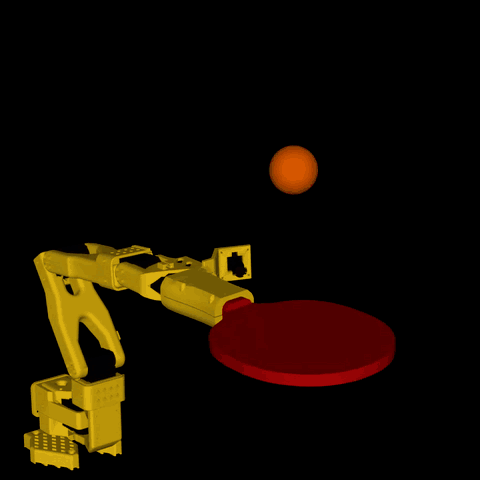

# SO-101 Ping Pong Bouncer

  

An SO-101 arm holding a ping pong paddle keeps a ball bouncing in place. The policy is trained with RL in
MuJoCo Warp (via [mjlab](https://github.com/mujocolab/mjlab)) and is meant to run zero-shot on the real arm,
with the ball tracked by an overhead and a wrist camera.

The clip is the `residual_v3` policy in simulation.

| Path | What |
|---|---|
| [`sim/`](sim/README.md) | Simulation, training, policy export and the real-rig control loop |
| [`docs/`](docs/) | Hardware and camera setup |
| [`cad/`](cad/) | Paddle measurements, paddle holder and overhead camera mount |
| [`measurements/`](measurements/) | Ball, servo, calibration and real-run data |
| [`TODO.md`](TODO.md) | Plan, results and decisions |
