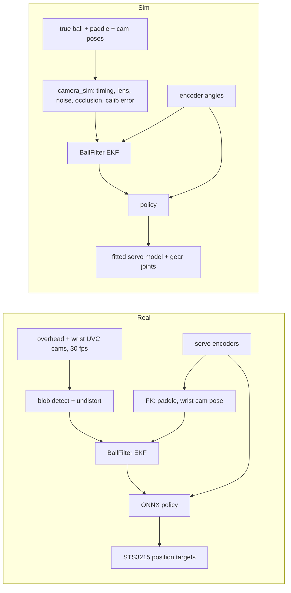

# SO-101 Ping Pong Bouncer — Plan & TODO

Goal: SO-101 arm holding a ping pong paddle keeps a ball bouncing in place, trained with RL in
MuJoCo Warp (via mjlab), deployed zero-shot with camera ball tracking (overhead + wrist camera).

Papers referenced below are kept locally in `research/` (PDFs git-ignored; file names carry year, authors, arXiv id).

Prior art on the exact task: [@praneethsamine](https://x.com/praneethsamine/status/2117447732176830940)
got an SO-101 bouncing a ball (avg ~13 bounces, best 23) with RL trained in Isaac Sim, overhead + wrist
camera, zero real demos. His reported blockers, all addressed below:

- real paddle/ball far less bouncy than sim → measure restitution first (§5)
- servos much slower under load than modeled → BAM actuator model (§1)
- paddle a few degrees off flat → ball rolls off → mount alignment + calibration (§2, §3)
- getting the initial bounce going → launch phase in the task (§3)
- camera calibration, joint offsets → extrinsic calibration (§3)
- safety with hand-dropped ball → wait-for-detection, hand disturbances, occlusion, false detections in sim (§3)

---

## 1. Base SO-101 model & servo model

| Asset | What it is | Caveats |
|---|---|---|
| [TheRobotStudio `Simulation/SO101`](https://github.com/TheRobotStudio/SO-ARM100/tree/main/Simulation/SO101) | Onshape-exported URDF + MJCF (new/old calib) | Motor params "adapted from Open Duck Mini" |
| [Menagerie `robotstudio_so101`](https://github.com/google-deepmind/mujoco_menagerie/tree/main/robotstudio_so101) | Cleaned MJCF: primitive collisions, implicitfast, camera mount | **Use this as the base** |
| [Rhoban BAM](https://github.com/Rhoban/bam) | Fitted STS3215 friction model (load-dependent, Stribeck, drive vs back-drive), mjlab/Warp API | **No backlash** |

Gaps in the stock model:

- [x] **Backlash** — measured: no free play at the encoders (fitted to 0); gear compliance instead (§1 fit below).
- [x] **Servos ~100× too stiff** — stock `kp=998 N·m/rad`; replaced by the fitted STS3215 model (below).
- [x] **Torque limit** — stock `forcerange` 2.94 N·m (3.35 upstream). Now the fitted model's current limit (3.0 A) and
      voltage/back-EMF; notes on the stock value: our 12 V servos stall at 30 kg·cm ≈ 2.94 N·m,
      so the stock limit matches stall; the real limit is the BAM voltage/back-EMF model, not a hard clamp. For
      reference the 7.4 V C001 [datasheet](https://files.seeedstudio.com/products/Feetech/108090023_STS3215-C001_Datasheet.pdf):
      stall 19.5 kg·cm ≈ 1.91 N·m, no-load 0.192 s/60° ≈ 5.45 rad/s, 0.088° resolution, 1:345.
- [ ] **No delays** — BAM doesn't model bus/actuator delay; measure on the assembled arm, randomize.
- [x] **Servo variant** — Feetech STS3215 **12 V, 30 kg·cm** (bought 12), on a 12 V supply. BAM ships only 7.4 V
      STS3215 params: `sim/scripts/make_sts3215_12v_params.py` keeps them and scales kt/R by the datasheet ratios
      (C018: 30 kg·cm, 0.222 s/60°). BAM's 7.4 V fit already exceeds its datasheet stall by 1.8× (3.43 vs 1.91 N·m),
      so the scaled 12 V model gives 5.3 N·m stall, 5.0 rad/s no-load: optimistic until fitted. Run the scripted
      bouncer go/no-go (step 5) also with a datasheet-level torque. Fit from recordings (option A, below).
- [x] **Firmware gains** — BAM models the firmware P term only (duty = error · P · gain, rate-limited target);
      its recorder writes D = 0 and never sets I, so the published fits assume I = 0, D = 0. so101-mcp currently
      writes P/I/D = 16/0/32 pan, 64/8/32 lift, 64/8/32 elbow, 32/0/32 wrist_flex, 64/8/32 roll. Ping-pong deploy
      writes its own profile: same P, **I = 0, D = 0, Acceleration 0** (decided after the D = 0 / 32 recordings);
      the sim uses exactly that. P can be re-tuned in sim before deployment.
- [x] **Servo recording, option A — on the arm** (do this; no extra hardware): `sim/scripts/record_servos.py`
      (`map` once, then `record`; `--sim` runs the same plan on the model). Writes the gain profile, then at three
      level-blade poses per joint: steps (3 sizes, both ways), slow reversals, 0.3–5 Hz chirp; then 20 s of
      bounce-like motion; ~8 min, logs goal/position/velocity/load/current/voltage/temperature with host
      timestamps → `measurements/servo/<time>/`. Plan checked in sim before it runs (limits, table, blade vs arm);
      Ctrl-C returns to the start pose. Then fit BAM params + delay + backlash against the full MuJoCo model.
      Run 1 (`measurements/servo/2026-11-08_212508`, D = 0, complete): step rise on lift/elbow matches the unfitted
      12 V model; real arm rings at ~2.7 Hz, ±1–4° for ~0.5 s after steps (sim doesn't). Temperature/voltage
      registers glitch single samples (up to 150 °C, 9.7 V); real: ≤ 43 °C, ≥ 11.5 V.
      Run 2 (`2026-11-08_213640`, `--d-gain 32`): overshoot 14 → 11 % (lift), 7 → 3 % (pan); ringing p2p unchanged
      (lift 2.0 → 1.6°, pan 2.2 → 2.3°), chirp tracking slightly worse. The ringing is the coupled arm: a lift step
      moves the holding elbow 5.3° and wrist 2.8° (sim 3.0° / 1.9°), wrist_flex steps move lift/elbow 2.5–3°
      (sim 1°) → holding joints are softer than the model (backlash, low stiffness near zero error). Fit must
      capture this. **Deploy gains decided: D = 0** (BAM's model, D buys little).
      **Fit** (`sim/scripts/fit_servos.py` → `sim/src/pingpong_sim/assets/actuators/sts3215_12v_fit.json`, report
      `measurements/servo/fit_2026-11-08_221524/`): CMA-ES over 26 params of `servo_model.py` (BAM m6 physics +
      gear compliance + command delay + firmware feedback delay + current limit), fit on ready/near_low, tested on
      far_high + bounce motion. Held-out RMS 0.44/0.75/0.60/0.38/0.14° → 0.35/0.71/0.49/0.37/0.10°
      (pan/lift/elbow/wrist/roll); "arm does exactly what it's told" would be 1.2–1.8°. Rise, overshoot and timing
      match; command delay 8.7 ms, current limit 3.0 A (register says 2.0 A), gears stiff (110–590 N·m/rad), no
      measurable free play (backlash fitted to 0 in an earlier run), feedback delay ≈ 0.
      **Not reproduced:** after a neighbour moves, real holding joints hunt at 3–4 Hz, ±1° for > 1 s (elbow p2p
      during lift steps: real 2.78°, sim 2.0°). Neither gear springs nor feedback delay reproduce it without
      worsening the fit. Plan: cover it with randomization in training (gear stiffness, feedback delay,
      disturbance torques on holding joints), and check the trained policy's paddle-tilt sensitivity to it.
- [x] Fitted model in training: `sim/src/pingpong_sim/servo_actuator.py` (mjlab actuator around `ServoModel`;
      gear joints are part of `robot.get_spec`). `get_robot_cfg(randomize=True)` draws a servo per world at each
      reset (`DEFAULT_RANDOMIZATION`: shared params ×/÷1.1–2 by how well the fit pinned them, gear stiffness
      80–600 N·m/rad, command delay 4–20 ms, feedback delay 0–6 ms, supply 11.5–12.3 V, OU disturbance torque
      std 0–0.08 N·m). Checks: the mjlab path replays the recording within 0.02–0.19° of the fitter's replay;
      randomized 0.3 rad steps: lift/elbow overshoot 10–31 % (real 14 %), pan ≤ 6 % (real 7 %, slightly under).
      Hunting is likely PLA flex under hard commands (user, 2026-11-08) → covered by the stiffness/disturbance ranges.
- [ ] **Servo recording, option B — spare-servo pendulum bench** (backup, only if option A's fit is poor): printed
      desk bracket + 100–150 mm bar + 2–3 weighed masses (100–500 g); daisy-chain the spare on the arm's bus as
      ID 7; record BAM's trajectories (incl. `lift_and_drop` for backdrive friction) and fit with BAM.

## 2. Paddle attachment (sim + print)

Paddle: **NIBIRU SPORT set (ASIN B098TYG4M5)** — 5-ply wood blade, inverted sponge rubber, flared handle,
3-star ABS 40 mm balls. No published dimensions/weight → measure everything.

Sim model edit (via `MjSpec` in mjlab, not a forked XML):

- [x] Remove `gripper` + `moving_jaw` bodies.
- [x] Add paddle body on the wrist-roll link: blade collision as a convex prism of the rubber region, visual mesh from CAD.
      Placement in the `gripper` body frame (origin on the horn face, roll axis = z): holder meshes at
      `quat="0 1 0 0"` like the stock follower; paddle axis = −z, blade normal = ±x, butt at z = −9 mm,
      paddle CoM at z = −133.6 mm, blade face centroid at z = −180.6 mm (`cad/paddle/derived.yaml` + 9 mm).
- [x] Gear-compliance joints, fitted servo actuator (§1).

Mount geometry:

- Blade plane contains the wrist-roll axis (handshake grip): `wrist_flex` = pitch, `wrist_roll` = roll,
  pan/lift/elbow = position. Exactly the 5 DoF needed; yaw about the face normal is irrelevant.
- Paddle CoM on the roll axis → low roll inertia. Removing the gripper servo saves ~55 g at the wrist.
- Torque: per decision, the stock paddle is fine (@praneethsamine's run confirms it works); the real cost is
  servos being **slower under load**, which BAM covers.

Paddle digitization (data + derivation in [`cad/paddle/`](cad/paddle/); rerun with `uv run cad/paddle/derive.py`):

- [x] Mass 151 g, balance point 124.6 mm from the butt, on the centerline/mid-plane.
- [x] Blade outline: pencil trace on Letter paper, photo rectified, pencil offset removed → `outline.csv` / `outline.dxf`.
- [x] Thicknesses: wood core 6.6 mm, rubber + sponge 2.0 mm per side.
- [x] Handle cross-sections at 5 stations; rounded rectangle, r ≈ 8 mm, symmetric about the blade mid-plane.
- [x] Inertia estimated from a 3-material model fitted to mass + balance point (`derived.yaml`).
- [ ] Optional: bifilar-pendulum check of the inertia (needed only if sim sysid points at the paddle).

Mount design (replaces the follower wrist-roll part):

Onshape (public, free plan): [SO-101 Ping Pong Paddle Holder](https://cad.onshape.com/documents/82d0b8811e842acce82a5fa2/w/2166488813b293f9fe12d64e/e/24cae980fe8bf3b3bc1bd132)
— the `SO101 Assembly` tab is the upstream assembly STEP imported as one Part Studio in its assembled pose.
Modeling goes through the Onshape Labs FeatureScript MCP (`onshape` in `~/.omp/agent/mcp.json`).

Holder v1: [`cad/holder/paddle_holder.fs`](cad/holder/paddle_holder.fs) (source of truth, also in the Onshape
document's `Paddle holder FS` tab) + exported STEP/STL (mm) for both halves.

- [x] Horn interface copied from `Wrist_Roll_Follower_SO101.step` (same 4 M3 screws, same roll zero).
- [x] Two-piece clamp split on the blade plane, pocket lofted from the caliper sections (0.2 mm clearance,
      0.8 mm split gap → 0.4 mm squeeze), handle waist locks the paddle axially, 4× M3x10 into M3x6 heat-set inserts.
- [x] Blade plane contains the roll axis and the wrist_flex axis direction at roll = 0.
- [x] Collision sweep vs the stock assembly over the full roll range (`cad/holder/preview_on_arm.py`): clear of
      the stationary wrist parts, holder + camera mount + camera included (min 0.58 mm to the wrist bracket).
- [x] Prints with support only under the horn boss: horn and camera holes teardropped like the stock follower;
      45° chamfers where the sleeve and camera pad meet the bed; bridged steps under the cap's counterbores.
      (A keel under the boss would hit the wrist bracket, which comes to r = 12.6–15 mm just behind the horn.)
- [x] Wrist camera: stock `SO101_Wrist_Cam_Hex-Nut_Mount_32x32_UVC_Module` adapter on the −y side (robot's
      left at roll = 0, blade level, cap up), same pose as on the stock follower; 2× M3x8 + 2× M3 nuts in nut
      traps (base nut from the split face, cap nut from the cap's top face). Camera looks forward and 25° inward,
      ~3.5 mm above the blade plane, so it sees the blade nearly edge-on (ball height above the blade, not the
      face). Adds ~35 g on the roll link: include mount + camera in the sim body.
- [x] Print 1 (PLA): the cap's 5.7 × 2.7 nut trap (opening on its print bed) wouldn't take the nut; the base's
      did. Traps now 5.9 × 2.9, the cap trap has a mouth relief, and `make_print_project.py` adds a support
      blocker over it (otherwise the slicer grows a support tree up the trap). Insert holes 4.0 → 3.8 mm
      for 4.2 mm OD inserts (the print-1 base keeps 4.0). Cap reprint: `make_print_project.py --parts cap`.
- [ ] Print (each half on its flat outer face, PETG/PA-CF) and test-fit the handle; adjust clearance/gap.
      Print 1 (PLA, 0.2 mm clearance, 0.8 mm gap): handle seats snug by hand and doesn't move once clamped; keep
      both values. Pending: cap nut, inserts, assembly.
- [x] Weighed (1 g scale): cap 25 g, base 35 g (each with its inserts/screws), camera mount + camera module +
      screws/washers 22 g. Wrist payload ≈ 60 g holder + 22 g camera + 151 g paddle = 233 g.
- [ ] Measure mount stiffness.
- [ ] AprilTag on the blade back for calibration (§3): printed (tag36h11 ID 0, 70.1 mm, `make_calib_targets.py`);
      glue it flat on the base-side face.
- Quick first test without CAD: clamp the handle in the stock gripper jaws (adds gripper compliance/backlash).

## 3. mjlab training setup (decided: mjlab)

Stack: [mjlab](https://github.com/mujocolab/mjlab) (Isaac Lab API on MuJoCo Warp) + rsl_rl PPO.
Has delayed/learned/PD actuators, actuator DR, rsl_rl RNN models; BAM integrates directly.
Reference: Rhoban [`mjlab_microban`](https://github.com/Rhoban/mjlab_microban) (STS3215 + BAM + mjlab sim2real).

- [x] uv project `sim/` (see `sim/README.md`): Python 3.12, stack pinned by `better-actuator-models[mjlab]==1.0.3`
      (mjlab 1.3, mujoco / mujoco-warp 3.7, warp 1.12). RTX 3090: ~2 M physics steps/s at 4096 envs (1 ms step,
      unoptimized harness loop).
- [x] Robot asset (`sim/src/pingpong_sim/robot.py`): Menagerie SO-101 minus gripper + holder/camera/paddle meshes
      exported in the holder frame (`cad/holder/export_sim_meshes.py`), measured masses (wrist-roll payload 233 g),
      blade collision = convex prism of the rubber region; fitted servo actuator; ready pose by IK.
      Checks: no contacts over the full wrist-roll sweep at the ready pose; GPU hold/step response runs
      (sag ≈ 0.5° on lift/elbow/wrist; 0.3 rad step rises in 60–110 ms, 16 % overshoot at P = 64, D = 0).
- [x] Gear-compliance joints (replace backlash, §1).
- [x] Ball (`sim/src/pingpong_sim/ball.py`): free 40 mm thin shell, 2.75 g, Cd 0.50 via MuJoCo's ellipsoid fluid
      model (works on MJWarp 3.7 only with the Euler integrator → Euler everywhere; blunt coefficient = Cd / 2).
- [x] Ball–paddle contact: explicit ball–blade pair, `solref (0.01, 0.19)`, stiff friction `solreffriction
      (0.002, 1)`, 1 ms step. Linear spring-damper → speed-independent e = 0.58 ± 0.035 (contact-phase scatter);
      `sim/scripts/validate_ball.py` replays the drops: e within ±0.03 of the measured fit for v ≥ 1.5 m/s, 25 in
      impact speed 3.40 m/s (measured 3.40), 16.5° tilt normal e 0.57, tangential kept 0.60 (measured 0.4 ± 0.1;
      0.6 is the rolling limit, the most loss MuJoCo friction can give). Known gap: slow dribbles (< 1 m/s) bounce
      lower than real (sim 0.58 vs 0.65–0.75). A custom Warp impulse kernel would fix both gaps if they matter.
- [x] Task cfg (design agreed 2026-11-08; implemented 2026-11-09 in `sim/src/pingpong_sim/task/`, tasks
      `PingPong-Bounce-Residual` / `-Direct`, `sim/scripts/{train,play,eval_task}.py`). Differences from the design
      below: masses drawn once per world (mass changes force a model recompute); no per-world drag (MuJoCo Warp 3.7
      shares `geom_fluid`); no rolling-friction randomization (the stiff friction already gives the rolling limit);
      not yet: last bounce's measured apex/restitution as an observation, servo params in the critic, control
      jitter, curriculum. Zero-action residual (= scripted bouncer) in the env: median 6 bounces, mean 11.3, 9.8 %
      of episodes last 20 s.
  - **Episode:** 100 Hz policy, 20 s. Arm at ready (+ joint noise); ball held "in hand" 0–1 s, then released
    20–50 cm above the paddle, ±3 cm off centre, small velocity; some episodes start mid-flight. Fixed apex 0.25 m.
  - **Terminations:** ball 10 cm below the hitting plane; > 20 cm sideways; ball touches anything but the blade;
    paddle tilt > ~30°.
  - **Actor obs:** encoder angles (vs ready) + velocities (quantised, noisy); paddle face pos/normal/velocity via FK;
    ball pos/vel vs target from the **deployment ball filter** fed by simulated overhead + wrist cameras
    (`camera_sim.py`: 30 fps rolling shutter, latency, noise, blur, occlusion, dropouts, calibration and timestamp
    error), time since last measurement, KF uncertainty, tracked
    flag; predicted impact time/point/incoming speed (bouncer predictor); last 5 actions; ~50 ms joint history;
    last bounce's measured apex and restitution.
  - **Critic obs (privileged):** + true ball state, servo params of the world, restitution, delays, gear deflections.
  - **Actions:** 5 joint goals. Policy 1: **residual** on the scripted bouncer's goal. Policy 2: direct offsets from
    ready, for comparison.
  - **Rewards:** per bounce (blade contact sending the ball ≥ 5 cm up): bounce, apex from outgoing velocity vs
    0.25 m, predicted landing point vs target, contact near blade centre; per step: action rate, joint speed,
    servo current, joint-limit proximity; terminal penalty. No alive bonus (resting-ball exploit).
  - **Randomization:** servos (done); ball 2.5–3.0 g, e 0.50–0.66, friction ×/÷2, Cd 0.40–0.55; paddle mass/CoM ±5 %;
    cameras (`camera_sim.py` defaults: latency, noise, dropouts, calibration and timestamp residuals at 1.5× the
    calibration targets); wrist camera off in some episodes (it is optional); control jitter; occasional ball
    pushes. Curriculum from easy to full ranges.
  - **Benchmark:** `run_bouncer.py` conditions; beat the scripted bouncer (realistic row with the camera pipeline,
    see below: 10–21 %, median 12–13 bounces).
- [x] Ball pipeline shared by sim and deployment (`sim/src/pingpong_sim/ball_filter.py`, `camera_sim.py`; design and
      calibration findings below). Scripted bouncer, 20 s, 256 worlds, 0.25 m apex, default camera randomization:

      | Servos | Overhead + wrist | Overhead only |
      |---|---|---|
      | fitted | 62 % (median 43 bounces) | 77 % (44) |
      | randomized | 10 % (12) | 21 % (13) |

      Tracking error p50/p90 ~8 / 17 mm, velocity 0.05–0.07 / 0.17 m/s. Ideal cameras (no noise, exact calibration,
      30 ms latency) 98 %; careful-calibration residuals (3 mm / 0.3°, 1 mm / 0.5°, ±2 ms) 88 % / 94 % overhead only.
      The wrist camera does not pay off yet for the scripted bouncer (its mount error and encoder-FK pose cost
      more than its views add); keep it as an optional source and re-check with the RL policy.
- [ ] Tracking speed: rig + filter cost ~57 ms per control tick at 4096 worlds (launch-bound torch, ~40 ms of it the
      filter). CUDA-graph / fuse before long training runs. Deployment: filter 3.8 ms per tick on CPU (1 world).
- [x] Train `residual_v1` (2000 it × 4096 worlds, 26k steps/s, 2.8 h; trained without the ball/paddle physics
      randomization, evaluated with it). `eval_task.py`, 256 worlds × 40 s, same env and randomization:

      | | Episodes lasting 20 s | Bounces p10 / p50 / p90 | Mean |
      |---|---|---|---|
      | Scripted bouncer (zero action) | 7.4 % | 1 / 6 / 31 | 10.2 |
      | `residual_v1` (model_1999) | 90.5 % | 39 / 44 / 48 | 41.0 |

      Failures split evenly between drops and drift; tracking error p50/p90 8 / 17 mm. Training curve flat after
      ~iteration 100 (bounces per finished episode 38–41); action std 0.30 → 0.07.
- [x] `residual_v1` behaviour (`eval_task.py`, 256 worlds × 40 s, a second run: 91.7 % full episodes):

      | Per bounce | Scripted bouncer | `residual_v1` |
      |---|---|---|
      | Apex (target 250 mm) | 230 ± 86 mm | 215 ± 55 mm |
      | Next landing vs target, p50 / p90 | 44 / 117 mm | 13 / 32 mm |
      | Contact off blade centre, p50 / p90 | 15 / 45 mm | 10 / 24 mm |
      | Full 20 s at e 0.65–0.61 / 0.61–0.56 / 0.56–0.51 | 10 / 6 / 3 % | 89 / 94 / 91 % |

      The policy mostly fixes the aim (landing error ÷ 3.5) and stops depending on the restitution. It keeps the
      bouncer's stroke and timing: residuals ~1° median, 1.6–2.8° p90, 2–6° p99 per joint (measured against the
      goal the action was added to), impacts within a few ms of the scripted plan, joint speeds below the
      bouncer's (p99 ≤ 4.2 rad/s vs the 7.3 rad/s limit), never at a joint limit. Apex runs ~35 mm low; a few % of
      failures are the ball touching the arm or the paddle tilting.
- [x] Deploy-side controller shared with training (`sim/src/pingpong_sim/controller.py`): `BounceController`
      (encoder arm history → ball filter on detections → scripted bouncer; actor observation terms, which the
      mdp terms now call) and `OnnxPolicy` (`policy.json` layout and histories → onnxruntime → servo goals).
      Training behaviour unchanged by the extraction (identical eval output before/after).
- [x] ONNX export (`sim/scripts/export_policy.py` → `sim/policies/<name>/policy.onnx` + `policy.json`, checked
      against PyTorch: max |Δ| 9e-7).
- [x] Sim-to-sim (`sim/scripts/sim2sim.py`): the exported policy on CPU MuJoCo (MuJoCo C, same scene and solver
      options) through `BounceController` + `OnnxPolicy`, same servo model, cameras, launch, randomization and
      terminations. `residual_v1`, 96 episodes: 92.7 % full 20 s, bounces 40 / 44 / 48, apex 214 ± 57 mm, landing
      13 / 31 mm, tracking 8.4 / 17.5 mm — the same as MuJoCo Warp (91.7 %, 40 / 44 / 47, 215 ± 55, 13 / 32, 8.3 / 17.3).
- [x] Reward fix (`a88f97c`): per-bounce rewards × exp(−((apex − 0.25) / 0.1)²). The unweighted reward let
      `direct_v1` (stopped at iteration 164) dribble ~5 bounces/s just above the 5 cm minimum.
- [x] `residual_v2` (600 it, with the ball/paddle physics randomization, old reward weights): not better.
      Same env, 256 worlds × 40 s: 88.0 % full 20 s (v1 in the same run: 91.3 %), bounces 22 / 44 / 47 (v1
      40 / 44 / 47), apex 214 ± 55 mm, landing 12 / 29 mm, smaller residuals (p99 1.3–4.5°). sim2sim 90.6 %.
      v1 already handled the randomized physics; **`residual_v1` stays the deployment candidate**, v2 exported too.
- [x] Bounce counting fix (`49da35d`): one bounce per fall (the ball must fall faster than 0.5 m/s between
      counted bounces). `direct_v2` (stopped at ~760 it) had learned to tap the rising ball right after each hit:
      90 counted per 20 s at a 214 mm apex where ~46 fit. Recounted with the fix (same episodes): 84.8 % full
      20 s, 14 / 50 / 52 bounces, apex 214 ± 52 mm, landing 19 / 40 mm. `residual_v1` recounts unchanged.
- [x] `direct_v3` (1000 it, apex-weighted rewards, one bounce per fall; goals = ready + 0.5 rad × action). Summary,
      `eval_task.py` 256 worlds × 40 s (sim2sim: 96 episodes on CPU MuJoCo through the deploy code path):

      | | Scripted | `residual_v1` | `residual_v2` | `direct_v3` |
      |---|---|---|---|---|
      | Full 20 s | 6–7 % | 92 % (sim2sim 93 %) | 88 % (91 %) | 88 % (89 %) |
      | Bounces p10 / p50 / p90 | 1 / 6 / 29 | 40 / 44 / 48 | 22 / 44 / 47 | 28 / 47 / 51 |
      | Apex (target 250 mm) | 230 ± 86 | 214 ± 55 | 214 ± 55 | 222 ± 55 |
      | Landing error p50 / p90 (mm) | 44 / 117 | 13 / 32 | 12 / 29 | 14 / 34 |
      | Failures by paddle tilt | 0 % | 2 % | 3 % | 16 % |

      The direct policy learns the whole stroke (goals 6–18° from ready at p90 on lift/elbow/wrist_flex) and gets
      close, but tilts the paddle into failures more and does worse on the bounciest balls (81 % at e 0.61–0.65).
      **Deploy `residual_v1` first**: best numbers, small corrections on top of a stroke that is explainable and
      works on its own (zero action = the scripted bouncer).
- [x] Deploy runtime, written and run in sim (`docs/hardware_setup.md`, "Bring-up and calibration"):
      `real/cameras.py` (UVC capture threads, V4L2 buffer timestamps, HSV ball detector), `real/camera_model.py`
      (fisheye lens + pose + timing files; pixels → filter measurements), `scripts/run_robot.py` (100 Hz: encoders
      with backward-difference velocities — Present_Velocity reads ~0.8×, lags ~20 ms — and detections →
      `BounceController` → `OnnxPolicy`; WAIT/PLAY/RECOVER episodes, goal limits, watchdog, logs).
      `run_robot.py --sim` (CPU MuJoCo arm, ball, cameras emitting real-format pixels): bounces continuously, 100 %
      tracked. Needed single-world CPU fast paths (filter propagation, impact prediction, kinematic chain; equal to
      the batched ones, `tests/test_fast_paths.py`): work per tick p50 20 → 2.5 ms, p99 49 → 4.9 ms.
- [ ] On the hardware: camera exposure/colour thresholds and buffer timestamps (`cameras.py preview`), calibration
      (below), `run_robot.py --scripted`, then `--policy policies/residual_v1`.

No camera rendering in the RL loop: train on the deployment filter fed by simulated detections.

Cameras (decided 2026-11-09): two InnoMaker U20CAM-720P (the SO-ARM100 32x32 UVC module): 1280x720 MJPEG, 30 fps,
rolling shutter, 102° × 59° (120° diagonal) lens with strong barrel distortion. Mounting and image settings:
[`docs/camera_setup.md`](docs/camera_setup.md).

- **Overhead:** SO-ARM100 overhead mount (lens ~0.55 m up, plate tilted 25° from straight down), standing on its own
  24 in (0.61 m) in front of the arm base, looking back at the bounce (~18 cm in front of the ball column).
- **Wrist:** on the paddle holder (`sim/src/pingpong_sim/robot.py` `WRIST_CAM_POS`), ~0.2 m behind the blade centre
  at blade height, looking along the paddle at it: sees the ball up to ~0.25 m above the blade in the y
  orientation, in the paddle's own frame.
- **Mount both with the image long side along the tilt / blade normal** (overhead: long side pointing from the post
  toward the arm; wrist: image taller than wide with the blade level). Sim: ball in view in ~80 % / ~55 % of
  frames vs ~45 % / ~25 % rotated 90°; bouncer survival 38 % vs 12 % (default randomization). Overhead alone turned
  (fitted servos, 20 s): 62 % → 31 % with both cameras, 77 % → 11 % overhead only. The stock overhead plate only
  takes the board across: print `cad/overhead_mount/cam_mount_top_rotatable.stl` (plus-shaped cutout).
- **Manual exposure** ≤ 2 ms with bright light (auto exposure indoors is 10–30 ms: 2–7 cm of blur at 2.4 m/s).
- Ball pipeline (`sim/src/pingpong_sim/ball_filter.py`, shared with deployment; `camera_sim.py` for sim): per-camera
  EKF updates in undistorted image coordinates + apparent size (one camera alone fixes 3D), paddle-aware
  prediction through bounces (from encoder FK), latency compensation, out-of-order detections, chi² gating
  (false detections), monocular track start. Timestamp uncertainty and calibration residuals enter as measurement
  noise — without that, two slightly inconsistent cameras make the velocity zig-zag (survival 15 % → 88 %).
  Consumers must wait for a converged track (velocity std < 0.5 m/s): planning on a one-frame track sank the
  first bounces.

Calibration — the sim says systematic errors dominate (scripted bouncer, everything else ideal: ±5 ms timestamp
bias → 20 % survive, ±2 ms → 45 %; overhead extrinsics 1 cm/1° → 23 %, 3 mm/0.3° → 66 %; wrist mount 2 mm/2° → 54 %,
1 mm/0.5° → 81 %; latency itself, 15–60 ms + readout, with correct timestamps → 85 %). Targets: overhead
extrinsics ≤ 3 mm / 0.3°, wrist mount ≤ 1 mm / 0.5°, per-camera timestamp offset ≤ ±2 ms. Training randomizes 1.5×.

Calibration code: `scripts/calibrate.py` + `real/calib_solve.py`; `calibrate.py selftest` recovers known answers from
synthetic data (overhead 0.86 mm / 0.06°, joint offsets 0.17°, wrist mount 0.21 mm / 0.03°, timing 0.16 ms, gravity
tilt 0.05°). Targets printed (`make_calib_targets.py`: tag + 5×7 ChArUco of 30 mm on Letter, exact scale).

- [x] Intrinsics per camera (ChArUco board), 2-term fisheye: overhead f 833, 0.38 px, 97×51°; wrist f 827, 0.63 px
      (lens fit covers the half of the wrist picture beyond the blade only).
- [x] Overhead extrinsics via the arm: `calibrate.py overhead`, 45 poses / 3 sessions, RMS ~3.6 px, ±4.4 mm /
      0.47° (leave-one-pose-out); elbow −7.7°, wrist_flex −0.2°, wrist_roll +1.7°. Pan and lift are not observable
      here (they trade off against the camera's yaw / pitch).
- [x] Shoulder-lift offset: **+9.75°** from the paddle height at ready (`calibrate.py lift --paddle-height-cm`,
      ruler 26.5 cm). Gravity with one camera (±3.5°) and the table-board tilt (+12.37°: the table under the board
      isn't level with the base to ~2.6°) were worse; the board height under +9.75 comes out −0.4 cm (ok).
- [x] Wrist camera mount: `calibrate.py wrist`; board flat on the table (measured by the overhead camera), 19 poses,
      RMS 5.2 px, 3.5 mm from CAD, module turned 91.4° about its axis from the CAD frame; leave-one-out ~6 mm / 1°
      (arm pose error flipped over, ~1–2°). Hand-held and propped boards failed (drift). Target 1 mm / 0.5° not met.
- [x] Timestamp offset per camera: overhead stamp −4.6 ms + 33.1 ms × row, wrist +4.8 ms + 24.8 ms × row (~±1 ms;
      residual 9–14 px is backlash at the wave's reversals).
- [ ] Validate the frame tilt: phone level on the table next to the base (front-back, side-side); the robot frame is
      the base plane, so the table's tilt is gravity's tilt in it. Tossed-ball gravity isn't reliable enough: the
      two-camera run tilted 8.6° sideways / 6.5° about the lift axis while the cameras agree (overhead point ~1 mm
      off the wrist ray on average, 11 mm RMS). Not hand release/catch (trimming arc ends makes it worse) and not
      the timing calibration (the older recording gives +1.6° sideways under today's calibration); the new tosses
      ran sideways (7 of 11 toward +y) and the overhead range-from-size drifts ~±7 % across the picture (vs the
      wrist ray, 65 overlapping detections). Size scales from it kept: overhead 1.074, wrist 0.920 (±0.02).
      Frame tilt matters: 1° ≈ the paddle-tilt error in §4 (~3 cm drift/bounce).
- [x] Level check: a ball set down at the centre of the paddle at ready (`arm_pose.py ready`) stays put: the paddle is
      level in true gravity to ~1° (lift +9.75°, table tilt and the other offsets together). Ball-flight gravity
      couldn't resolve it (drops: 0.13–0.23 s arcs, hand hides the ball from the overhead camera; ±2–6°).

## 4. Task physics / feasibility

Steady state: $v_{out} = -e\,v_{in} + (1+e)u$ ⇒ required paddle speed $u = v\frac{1-e}{1+e}$.

| Apex height | Impact speed | Time between hits | Paddle speed at e = **0.58 (measured)** / 0.7 / 0.8 | Drift per hit from 1° tilt (e=0.8) |
|---|---|---|---|---|
| 0.15 m | 1.72 m/s | 0.35 s | **0.46** / 0.30 / 0.19 m/s | 1.9 cm |
| 0.25 m | 2.21 m/s | 0.45 s | **0.59** / 0.39 / 0.25 m/s | 3.1 cm |
| 0.35 m | 2.62 m/s | 0.53 s | **0.70** / 0.46 / 0.29 m/s | 4.4 cm |

- Speed/torque easy: ball impulse ≈ 0.01 N·s; the paddle is effectively a driven surface.
- **Orientation is the hard part**: up to 3 servos × ±0.5° backlash in paddle pitch vs ~3 cm drift per degree.
- Air drag is 7–15% of weight at 2.2–3.3 m/s (measured Cd 0.50) — not negligible.
- 0.35–0.53 s between hits vs ~30–60 ms latency (estimate; measure). Higher apex = more reaction time;
  @praneethsamine found low bounces hardest with these servos.
- Mirror law / decelerating paddle at impact makes bounce height passively stable (Schaal & Atkeson '93).

## 5. What to measure

Ball:

- [x] 40 mm, 2.75 g (4 balls = 11 g, 1 g scale). ITTF bounce 240–260 mm from 305 mm onto steel ⇒ e ≈ 0.89–0.92 on steel, **not** on the paddle.
- [x] Drag: Cd = 0.50 ± 0.03 from the 16–25 in paddle-drop falls (6 ft floor drops too blurred to pin it down);
      `measurements/ball/` (240 fps iPhone slow-mo, 35 videos, `analyze.py` reproduces `results.yaml`).

Ball on paddle (slow-mo phone or the stereo rig):

- [x] Restitution vs impact speed (clamped holder, blade centre, 119 impacts): e = 0.578 + 0.373·exp(−v/0.54 m/s),
      scatter 0.037 → 0.75 at 0.4 m/s, 0.60 at 1.7 m/s, 0.57 above 2.5 m/s. Far below the 0.7–0.9 assumed earlier.
- [ ] Restitution across the blade: edge, near the mount (only centre drops so far).
- [x] Oblique drops (blade tilted 16–17°, 2 videos): normal e matches the centre fit; 0.37–0.41 (±0.1) of the
      tangential speed kept.
- [ ] Same rubber side every time.

Paddle as payload:

- [x] Mass, CoM, inertia, blade + rubber thickness (§2).
- [ ] Mount offset (§2).
- [ ] Mount stiffness.

Arm:

- [ ] Backlash per joint (paddle AprilTag + camera while reversing each joint).
- [ ] Command→motion delay.
- [ ] Firmware P gain, acceleration, voltage — must match sim.
- [ ] Optional own BAM / `mujoco.sysid` fit from recorded joint sweeps.

Perception:

- [ ] Per camera: intrinsics, readout time, end-to-end latency (capture → detection on the host), detection noise
      (px) and false-detection rate under the real lighting.

## 6. Robustness: randomization & memory

Domain randomization ranges:

- restitution, paddle friction, drag, ball mass
- latency 15–60 ms + readout, observation noise, dropouts, false detections, calibration and timestamp offsets
- backlash 0–1° per joint, BAM friction ±30%, gains, supply voltage
- paddle mass/CoM, mount stiffness

Ball flight is near-deterministic given position + velocity (Kalman filter). Memory helps with the **latent,
drifting** parameters (this paddle's restitution, latency, backlash, sag), which only show up across bounces.

- [ ] Step 1: MLP policy with
  - KF ball estimate
  - predicted impact point / time / apex from a gravity+drag model (PACE-style)
  - 0.5–1 s history of observations + actions
- [ ] Step 2: asymmetric critic with privileged sim state (true ball state, restitution, delays).
- [ ] Step 3: GRU/LSTM (rsl_rl) only if step 1 can't adapt to randomized restitution/latency;
      teacher-student (RMA-style) as the next fallback.

---

## Suggested order

1. [x] Measure: ball drops on the paddle (35 videos), paddle mass properties, holder/camera weights.
2. [x] Design + print mount.
3. [x] Sim step 1: analyze drop videos (restitution vs speed, drag, rubber grip); `sim/` uv project; SO-101 +
       holder + camera + paddle model with the datasheet-scaled 12 V servo model; ball contact fitted to the drops.
4. [x] Servo recording option A on the arm → fitted servo model, delays, gear compliance (§1).
5. [x] Scripted bouncer in sim (`sim/src/pingpong_sim/bouncer.py`, `sim/scripts/run_bouncer.py`): drag-aware impact
       prediction, aim from the measured restitution, constant-acceleration single-joint (elbow) stroke, feedforward
       through an identified linear tracking model (`sim/scripts/identify_tracking.py`). 20 s runs, 0.25 m apex:
       fitted servos 100 % of worlds keep bouncing (44 bounces, apex 0.245 ± 0.023 m, impacts ~2 cm from target);
       + 30 ms ball latency (predicted forward, as the KF will) + 2 mm noise: 94 %; randomized servos: 56 %
       (median 43, p10 4); randomized + latency + noise: 30 %, median 15 bounces (cf. @praneethsamine's 13 avg).
       Lessons: without feedforward ~2 bounces (P-servoed arm resonates at the 3–4 Hz of a stroke); a level-face
       multi-joint stroke fails (elbow/wrist out of step cancels the face speed); predicting from the measurement
       time is essential. Failures under randomization: feedforward model is the nominal servo's. Optional: run
       it on the real arm (ball state from the cameras + ball filter) as a baseline/first demo.
6. [x] RL in mjlab (`residual_v1` deploy candidate; sim2sim, ONNX export).
7. [x] Cameras (overhead + wrist UVC, §3) + calibration (extrinsics, wrist mount, timestamp offsets, lift offset
       from the paddle height; resting-ball level check). Results in §3 "Calibration".
8. [ ] Deploy. First real run, scripted bouncer, 60 s (`measurements/runs/2026-11-09_221010`): 1–3 bounces per
       ball, the ball leaves backwards (toward the base). Tracking agrees with each camera to 1–2 cm; passive first
       hits (arm still at ready) see a level paddle (−0.2 to −1.0°). Active hits: paddle tilt vs the bouncer's
       intent +1.5° median (tip-up) with 5.2° spread (the elbow-only stroke tilts the face at 50–170°/s), and the
       face moves toward the base at impact (median −0.07 m/s, rubber grips): both push ~5 cm/bounce backwards.
       Next: `residual_v1` on the real arm (sim check: 43 bounces in 20 s).
       `residual_v1` real run (`2026-11-09_221640`): same, 1–2 bounces. Diagnosis (both runs; replaying the logs
       through `BounceController` reproduces the logged estimate exactly):
       - Bounces die out: apexes fall bounce after bounce, the ball ends up dribbling and rolls off (the drift
         direction is just which way it rolls). The paddle's speed peaks 24–47 ms *before* the ball arrives
         (from the raw detections), so it is decelerating at contact (0.3–0.55 m/s vs 0.94–1.0 planned).
       - The arm follows the plan (tracking model vs real face speed: 0–10 ms, ×1.0–1.1); the bouncer's predicted
         impact is early: −28 ms median on real logs, +3 ms on a sim run through the same code.
       - The filter has the ball falling faster than the cameras see it; replaying with filter gravity 8.7 m/s²
         puts the predicted impacts on time (9.81: −28 ms, 9.0: −11, 8.3: +12). Ball flights measured per camera
         fall at −8.0..−8.7 m/s² (sim: −9.77 with the same analysis).
       - Ruled out: restitution (0.59 measured on real passive bounces), camera clock rate (buffer stamps vs
         arrival 1.0000), range-from-size scaling (slope 1.00–1.04 vs triangulation), filter noise settings, the
         filter's ~40 % gate rejections (sim shows the same).
       - Open: why the real ball appears to fall at ~8.7 m/s². Test: `run_robot.py --ball-gravity 8.7`
         (experiment flag; logged in meta.json warnings): "a tad better". Replay: still −19 ms; the paddle still
         peaks 31 ms before contact (0.12 m/s at contact). The same −19 ms in sim leaves 0.74 m/s at contact.
       - Corrected: the real arm follows the bouncer's plan (dry strokes, `record_servos.py strokes`: face speed on
         time, gain 0.99, 0.60 m/s at impact for 0.52 planned). An earlier "52–66 % of commanded" compared against
         the feedforward goal, not the plan. So the impact prediction (19–28 ms early) is what's wrong on the rig;
         the sim servo lags its plan ~10–20 ms, which masks the same early prediction in sim. Shorter strokes
         (0.10 / 0.08 s) track worse on the real arm (gain 0.73, corr 0.45; sim 1.00, 0.85).
       - Servo model refit with the strokes (`fit_2026-11-10_093618`): held-out stroke RMS lift/elbow/flex
         0.67/0.79/0.43 → 0.54/0.66/0.37°, but the sim servo still lags its plan ~10 ms (real: 0), tracks more
         cleanly (corr 0.85 vs 0.68) and gives short strokes more speed (gain 0.91 vs 0.73). Sim, refit servo, 256 ×
         20 s: 0.25 m 26 %, 0.15 m with stroke 0.10 / follow 0.08 37 %; with impacts predicted early (filter gravity
         11) 45 % / 65 %: in sim early strikes *help* (the arm lags), on the rig they hurt (the arm is on time). The
         stroke-to-ball timing differs between sim and rig: `BouncerCfg.impact_bias` (s, added to every predicted
         impact; rig ~+0.025, from the replays), `run_robot.py --impact-bias`; training should randomize it.
       - Sim, scripted, 256 worlds × 20 s, randomized servos, 30 ms latency: baseline 31 % still bouncing; impacts
         predicted early (filter gravity 11) 24 %; holding the hitting speed ±40 ms ("cruise") 1.6 % (dropped);
         apex 0.12 m 0–0.4 % (follow-through + approach + stroke no longer fit between bounces).
       - Plan: `record_servos.py strokes` on the arm (the bouncer's own strokes, no ball) → `identify_tracking.py
         --from` (stiffness/damping scales + command delay, output error, held-out series; the bouncer's lead
         defaults to its delay) and `fit_servos.py --run <2026-11-08_212508> <strokes>` → shorter stroke and
         follow-through for a ~0.15–0.18 m apex (the overhead camera, 0.51 m up, loses the ball above ~0.2 m) →
         retrain `residual` → real test. `run_robot.py` re-engages a ball falling back onto the blade during RECOVER.
       - Strokes recorded and the servo model refit (held-out stroke RMS −15–20 %). `residual_v3` retrain, so the
         policy *adapts* to timing mismatch instead of the tracker being tuned (`9ae9f5d`): per-episode filter +
         bouncer gravity belief 0.85–1.15 × g (the rig behaved like ~0.89), camera timestamp bias ±15 ms, servo
         command delay 0–20 ms, a 0.64 s history observation (ball estimate, blade height/speed, predicted time to
         impact, every 40 ms) and the mismatch in the critic; apex 0.15 m, stroke 0.10 / follow 0.08 s.
         Old policies run with their own `policy.json` settings. Compare with `sim2sim.py --belief-gravity`.
       - `residual_v3` (2000 it × 4096, 2.9 h; plateau from ~1400 at ~28.7 bounces per finished episode) vs
         `residual_v1`, sim2sim, 48 episodes each (±7 points), both in today's sim (refit servos, ±15 ms stamps,
         0–20 ms delay; v1 runs with its own 0.25 m / old stroke):

         | Filter/bouncer gravity belief | v1 full 20 s | v3 full 20 s | v1 / v3 bounces p50 |
         |---|---|---|---|
         | ×1.00 | 45.8 % | 60.4 % | 36 / 48 |
         | ×0.89 | 35.4 % | 58.3 % | 14 / 49 |
         | ×1.12 | 25.0 % | 45.8 % | 14 / 46 |

         v3 per bounce: apex 141 ± 45 mm (target 150), landing 17 / 46 mm, contact 10 / 26 mm off centre.
       - Correction (`b7071a7`): `calibrate.gravity_measurements` gave every wrist detection the arm pose at the
         end of the recording (a 32-tick ArmHistory fed the whole log). The gravity step held the arm still, so
         it was unaffected; the run-log analyses above (impact times from camera points, the wrist camera's
         flights) were not. Redone: impact predictions vs detected impacts −26 / +0 / −50 ms per run (n 9 / 14 / 7,
         wide spread), so "early" holds on average but not as a tight 19–28 ms. Overhead flights read 8.44 m/s²
         (no arm in them); triangulated range / overhead size-based range 1.088 with the ball at 0.20–0.30 m,
         1.00 above 0.35 m: the overhead camera puts a low ball ~2 cm too high (on 3 flights with enough pairs,
         triangulated 9.37 m/s², overhead size-based 8.54). Likely the red rubber's orange-ish edge joining the
         blob (cameras.py notes it). Next: paddle flipped (black hitting side, tag on the red side), recalibrate,
         `calibrate.py static --free`.

## Decisions

Decided:

- Paddle: NIBIRU SPORT stock paddle; torque considered fine.
- RL stack: mjlab (MuJoCo Warp) + rsl_rl PPO.
- Servos: 12 V STS3215 on all joints, 12 V supply.
- Contact model: built-in MuJoCo contact (explicit ball–blade pair) — matches the drops at task speeds; a custom Warp
  impulse kernel only if the slow-dribble or tangential gaps (§3) turn out to matter.
- Cameras: overhead + wrist InnoMaker U20CAM-720P (30 fps UVC, rolling shutter), long side along the tilt / blade
  normal (§3). Ball only + paddle tag for calibration; arm state from encoders. Ball filter in pixel space per
  camera, shared by sim and deployment.

Open (default in brackets):

- Extrinsic calibration: arm-moved paddle AprilTag or fixed base tag. [Arm-moved tag; it also catches joint offsets.]
