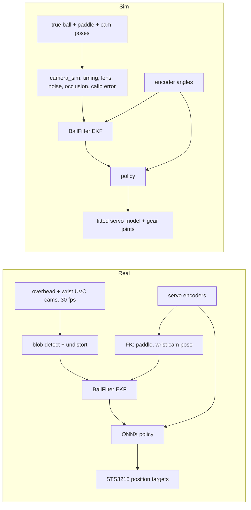

# SO-101 Ping Pong Bouncer — Plan & TODO

Goal: SO-101 arm holding a ping pong paddle keeps a ball bouncing in place, trained with RL in
MuJoCo Warp (via mjlab), deployed zero-shot with camera ball tracking (overhead + wrist camera).

Papers referenced below are kept locally in `research/` (PDFs git-ignored; file names carry year, authors, arXiv id).

Prior art on the exact task: [@praneethsamine](https://x.com/praneethsamine/status/2117447732176830940)
got an SO-101 bouncing a ball (avg ~13 bounces, best 23) with RL trained in Isaac Sim, overhead + wrist
camera, zero real demos. His reported blockers, all addressed below:

- real paddle/ball far less bouncy than sim → measure restitution first (§5)
- servos much slower under load than modeled → BAM actuator model (§1)
- paddle a few degrees off flat → ball rolls off → mount alignment + calibration (§2, §3)
- getting the initial bounce going → launch phase in the task (§3)
- camera calibration, joint offsets → extrinsic calibration (§3)
- safety with hand-dropped ball → wait-for-detection, hand disturbances, occlusion, false detections in sim (§3)

---

## 1. Base SO-101 model & servo model

| Asset | What it is | Caveats |
|---|---|---|
| [TheRobotStudio `Simulation/SO101`](https://github.com/TheRobotStudio/SO-ARM100/tree/main/Simulation/SO101) | Onshape-exported URDF + MJCF (new/old calib) | Motor params "adapted from Open Duck Mini" |
| [Menagerie `robotstudio_so101`](https://github.com/google-deepmind/mujoco_menagerie/tree/main/robotstudio_so101) | Cleaned MJCF: primitive collisions, implicitfast, camera mount | **Use this as the base** |
| [Rhoban BAM](https://github.com/Rhoban/bam) | Fitted STS3215 friction model (load-dependent, Stribeck, drive vs back-drive), mjlab/Warp API | **No backlash** |

Gaps in the stock model:

- [x] **Backlash** — measured: no free play at the encoders (fitted to 0); gear compliance instead (§1 fit below).
- [x] **Servos ~100× too stiff** — stock `kp=998 N·m/rad`; replaced by the fitted STS3215 model (below).
- [x] **Torque limit** — stock `forcerange` 2.94 N·m (3.35 upstream). Now the fitted model's current limit (3.0 A) and
      voltage/back-EMF; notes on the stock value: our 12 V servos stall at 30 kg·cm ≈ 2.94 N·m,
      so the stock limit matches stall; the real limit is the BAM voltage/back-EMF model, not a hard clamp. For
      reference the 7.4 V C001 [datasheet](https://files.seeedstudio.com/products/Feetech/108090023_STS3215-C001_Datasheet.pdf):
      stall 19.5 kg·cm ≈ 1.91 N·m, no-load 0.192 s/60° ≈ 5.45 rad/s, 0.088° resolution, 1:345.
- [ ] **No delays** — BAM doesn't model bus/actuator delay; measure on the assembled arm, randomize.
- [x] **Servo variant** — Feetech STS3215 **12 V, 30 kg·cm** (bought 12), on a 12 V supply. BAM ships only 7.4 V
      STS3215 params: `sim/scripts/make_sts3215_12v_params.py` keeps them and scales kt/R by the datasheet ratios
      (C018: 30 kg·cm, 0.222 s/60°). BAM's 7.4 V fit already exceeds its datasheet stall by 1.8× (3.43 vs 1.91 N·m),
      so the scaled 12 V model gives 5.3 N·m stall, 5.0 rad/s no-load: optimistic until fitted. Run the scripted
      bouncer go/no-go (step 5) also with a datasheet-level torque. Fit from recordings (option A, below).
- [x] **Firmware gains** — BAM models the firmware P term only (duty = error · P · gain, rate-limited target);
      its recorder writes D = 0 and never sets I, so the published fits assume I = 0, D = 0. so101-mcp currently
      writes P/I/D = 16/0/32 pan, 64/8/32 lift, 64/8/32 elbow, 32/0/32 wrist_flex, 64/8/32 roll. Ping-pong deploy
      writes its own profile: same P, **I = 0, D = 0, Acceleration 0** (decided after the D = 0 / 32 recordings);
      the sim uses exactly that. P can be re-tuned in sim before deployment.
- [x] **Servo recording, option A — on the arm** (do this; no extra hardware): `sim/scripts/record_servos.py`
      (`map` once, then `record`; `--sim` runs the same plan on the model). Writes the gain profile, then at three
      level-blade poses per joint: steps (3 sizes, both ways), slow reversals, 0.3–5 Hz chirp; then 20 s of
      bounce-like motion; ~8 min, logs goal/position/velocity/load/current/voltage/temperature with host
      timestamps → `measurements/servo/<time>/`. Plan checked in sim before it runs (limits, table, blade vs arm);
      Ctrl-C returns to the start pose. Then fit BAM params + delay + backlash against the full MuJoCo model.
      Run 1 (`measurements/servo/2026-11-08_212508`, D = 0, complete): step rise on lift/elbow matches the unfitted
      12 V model; real arm rings at ~2.7 Hz, ±1–4° for ~0.5 s after steps (sim doesn't). Temperature/voltage
      registers glitch single samples (up to 150 °C, 9.7 V); real: ≤ 43 °C, ≥ 11.5 V.
      Run 2 (`2026-11-08_213640`, `--d-gain 32`): overshoot 14 → 11 % (lift), 7 → 3 % (pan); ringing p2p unchanged
      (lift 2.0 → 1.6°, pan 2.2 → 2.3°), chirp tracking slightly worse. The ringing is the coupled arm: a lift step
      moves the holding elbow 5.3° and wrist 2.8° (sim 3.0° / 1.9°), wrist_flex steps move lift/elbow 2.5–3°
      (sim 1°) → holding joints are softer than the model (backlash, low stiffness near zero error). Fit must
      capture this. **Deploy gains decided: D = 0** (BAM's model, D buys little).
      **Fit** (`sim/scripts/fit_servos.py` → `sim/src/pingpong_sim/assets/actuators/sts3215_12v_fit.json`, report
      `measurements/servo/fit_2026-11-08_221524/`): CMA-ES over 26 params of `servo_model.py` (BAM m6 physics +
      gear compliance + command delay + firmware feedback delay + current limit), fit on ready/near_low, tested on
      far_high + bounce motion. Held-out RMS 0.44/0.75/0.60/0.38/0.14° → 0.35/0.71/0.49/0.37/0.10°
      (pan/lift/elbow/wrist/roll); "arm does exactly what it's told" would be 1.2–1.8°. Rise, overshoot and timing
      match; command delay 8.7 ms, current limit 3.0 A (register says 2.0 A), gears stiff (110–590 N·m/rad), no
      measurable free play (backlash fitted to 0 in an earlier run), feedback delay ≈ 0.
      **Not reproduced:** after a neighbour moves, real holding joints hunt at 3–4 Hz, ±1° for > 1 s (elbow p2p
      during lift steps: real 2.78°, sim 2.0°). Neither gear springs nor feedback delay reproduce it without
      worsening the fit. Plan: cover it with randomization in training (gear stiffness, feedback delay,
      disturbance torques on holding joints), and check the trained policy's paddle-tilt sensitivity to it.
- [x] Fitted model in training: `sim/src/pingpong_sim/servo_actuator.py` (mjlab actuator around `ServoModel`;
      gear joints are part of `robot.get_spec`). `get_robot_cfg(randomize=True)` draws a servo per world at each
      reset (`DEFAULT_RANDOMIZATION`: shared params ×/÷1.1–2 by how well the fit pinned them, gear stiffness
      80–600 N·m/rad, command delay 4–20 ms, feedback delay 0–6 ms, supply 11.5–12.3 V, OU disturbance torque
      std 0–0.08 N·m). Checks: the mjlab path replays the recording within 0.02–0.19° of the fitter's replay;
      randomized 0.3 rad steps: lift/elbow overshoot 10–31 % (real 14 %), pan ≤ 6 % (real 7 %, slightly under).
      Hunting is likely PLA flex under hard commands (user, 2026-11-08) → covered by the stiffness/disturbance ranges.
- [ ] **Servo recording, option B — spare-servo pendulum bench** (backup, only if option A's fit is poor): printed
      desk bracket + 100–150 mm bar + 2–3 weighed masses (100–500 g); daisy-chain the spare on the arm's bus as
      ID 7; record BAM's trajectories (incl. `lift_and_drop` for backdrive friction) and fit with BAM.

## 2. Paddle attachment (sim + print)

Paddle: **NIBIRU SPORT set (ASIN B098TYG4M5)** — 5-ply wood blade, inverted sponge rubber, flared handle,
3-star ABS 40 mm balls. No published dimensions/weight → measure everything.

Sim model edit (via `MjSpec` in mjlab, not a forked XML):

- [x] Remove `gripper` + `moving_jaw` bodies.
- [x] Add paddle body on the wrist-roll link: blade collision as a convex prism of the rubber region, visual mesh from CAD.
      Placement in the `gripper` body frame (origin on the horn face, roll axis = z): holder meshes at
      `quat="0 1 0 0"` like the stock follower; paddle axis = −z, blade normal = ±x, butt at z = −9 mm,
      paddle CoM at z = −133.6 mm, blade face centroid at z = −180.6 mm (`cad/paddle/derived.yaml` + 9 mm).
- [x] Gear-compliance joints, fitted servo actuator (§1).

Mount geometry:

- Blade plane contains the wrist-roll axis (handshake grip): `wrist_flex` = pitch, `wrist_roll` = roll,
  pan/lift/elbow = position. Exactly the 5 DoF needed; yaw about the face normal is irrelevant.
- Paddle CoM on the roll axis → low roll inertia. Removing the gripper servo saves ~55 g at the wrist.
- Torque: per decision, the stock paddle is fine (@praneethsamine's run confirms it works); the real cost is
  servos being **slower under load**, which BAM covers.

Paddle digitization (data + derivation in [`cad/paddle/`](cad/paddle/); rerun with `uv run cad/paddle/derive.py`):

- [x] Mass 151 g, balance point 124.6 mm from the butt, on the centerline/mid-plane.
- [x] Blade outline: pencil trace on Letter paper, photo rectified, pencil offset removed → `outline.csv` / `outline.dxf`.
- [x] Thicknesses: wood core 6.6 mm, rubber + sponge 2.0 mm per side.
- [x] Handle cross-sections at 5 stations; rounded rectangle, r ≈ 8 mm, symmetric about the blade mid-plane.
- [x] Inertia estimated from a 3-material model fitted to mass + balance point (`derived.yaml`).
- [ ] Optional: bifilar-pendulum check of the inertia (needed only if sim sysid points at the paddle).

Mount design (replaces the follower wrist-roll part):

Onshape (public, free plan): [SO-101 Ping Pong Paddle Holder](https://cad.onshape.com/documents/82d0b8811e842acce82a5fa2/w/2166488813b293f9fe12d64e/e/24cae980fe8bf3b3bc1bd132)
— the `SO101 Assembly` tab is the upstream assembly STEP imported as one Part Studio in its assembled pose.
Modeling goes through the Onshape Labs FeatureScript MCP (`onshape` in `~/.omp/agent/mcp.json`).

Holder v1: [`cad/holder/paddle_holder.fs`](cad/holder/paddle_holder.fs) (source of truth, also in the Onshape
document's `Paddle holder FS` tab) + exported STEP/STL (mm) for both halves.

- [x] Horn interface copied from `Wrist_Roll_Follower_SO101.step` (same 4 M3 screws, same roll zero).
- [x] Two-piece clamp split on the blade plane, pocket lofted from the caliper sections (0.2 mm clearance,
      0.8 mm split gap → 0.4 mm squeeze), handle waist locks the paddle axially, 4× M3x10 into M3x6 heat-set inserts.
- [x] Blade plane contains the roll axis and the wrist_flex axis direction at roll = 0.
- [x] Collision sweep vs the stock assembly over the full roll range (`cad/holder/preview_on_arm.py`): clear of
      the stationary wrist parts, holder + camera mount + camera included (min 0.58 mm to the wrist bracket).
- [x] Prints with support only under the horn boss: horn and camera holes teardropped like the stock follower;
      45° chamfers where the sleeve and camera pad meet the bed; bridged steps under the cap's counterbores.
      (A keel under the boss would hit the wrist bracket, which comes to r = 12.6–15 mm just behind the horn.)
- [x] Wrist camera: stock `SO101_Wrist_Cam_Hex-Nut_Mount_32x32_UVC_Module` adapter on the −y side (robot's
      left at roll = 0, blade level, cap up), same pose as on the stock follower; 2× M3x8 + 2× M3 nuts in nut
      traps (base nut from the split face, cap nut from the cap's top face). Camera looks forward and 25° inward,
      ~3.5 mm above the blade plane, so it sees the blade nearly edge-on (ball height above the blade, not the
      face). Adds ~35 g on the roll link: include mount + camera in the sim body.
- [x] Print 1 (PLA): the cap's 5.7 × 2.7 nut trap (opening on its print bed) wouldn't take the nut; the base's
      did. Traps now 5.9 × 2.9, the cap trap has a mouth relief, and `make_print_project.py` adds a support
      blocker over it (otherwise the slicer grows a support tree up the trap). Insert holes 4.0 → 3.8 mm
      for 4.2 mm OD inserts (the print-1 base keeps 4.0). Cap reprint: `make_print_project.py --parts cap`.
- [ ] Print (each half on its flat outer face, PETG/PA-CF) and test-fit the handle; adjust clearance/gap.
      Print 1 (PLA, 0.2 mm clearance, 0.8 mm gap): handle seats snug by hand and doesn't move once clamped; keep
      both values. Pending: cap nut, inserts, assembly.
- [x] Weighed (1 g scale): cap 25 g, base 35 g (each with its inserts/screws), camera mount + camera module +
      screws/washers 22 g. Wrist payload ≈ 60 g holder + 22 g camera + 151 g paddle = 233 g.
- [ ] Measure mount stiffness.
- [ ] AprilTag on the blade back for calibration (§3): printed (tag36h11 ID 0, 70.1 mm, `make_calib_targets.py`);
      glue it flat on the base-side face.
- Quick first test without CAD: clamp the handle in the stock gripper jaws (adds gripper compliance/backlash).

## 3. mjlab training setup (decided: mjlab)

Stack: [mjlab](https://github.com/mujocolab/mjlab) (Isaac Lab API on MuJoCo Warp) + rsl_rl PPO.
Has delayed/learned/PD actuators, actuator DR, rsl_rl RNN models; BAM integrates directly.
Reference: Rhoban [`mjlab_microban`](https://github.com/Rhoban/mjlab_microban) (STS3215 + BAM + mjlab sim2real).

- [x] uv project `sim/` (see `sim/README.md`): Python 3.12, stack pinned by `better-actuator-models[mjlab]==1.0.3`
      (mjlab 1.3, mujoco / mujoco-warp 3.7, warp 1.12). RTX 3090: ~2 M physics steps/s at 4096 envs (1 ms step,
      unoptimized harness loop).
- [x] Robot asset (`sim/src/pingpong_sim/robot.py`): Menagerie SO-101 minus gripper + holder/camera/paddle meshes
      exported in the holder frame (`cad/holder/export_sim_meshes.py`), measured masses (wrist-roll payload 233 g),
      blade collision = convex prism of the rubber region; fitted servo actuator; ready pose by IK.
      Checks: no contacts over the full wrist-roll sweep at the ready pose; GPU hold/step response runs
      (sag ≈ 0.5° on lift/elbow/wrist; 0.3 rad step rises in 60–110 ms, 16 % overshoot at P = 64, D = 0).
- [x] Gear-compliance joints (replace backlash, §1).
- [x] Ball (`sim/src/pingpong_sim/ball.py`): free 40 mm thin shell, 2.75 g, Cd 0.50 via MuJoCo's ellipsoid fluid
      model (works on MJWarp 3.7 only with the Euler integrator → Euler everywhere; blunt coefficient = Cd / 2).
- [x] Ball–paddle contact: explicit ball–blade pair, `solref (0.01, 0.19)`, stiff friction `solreffriction
      (0.002, 1)`, 1 ms step. Linear spring-damper → speed-independent e = 0.58 ± 0.035 (contact-phase scatter);
      `sim/scripts/validate_ball.py` replays the drops: e within ±0.03 of the measured fit for v ≥ 1.5 m/s, 25 in
      impact speed 3.40 m/s (measured 3.40), 16.5° tilt normal e 0.57, tangential kept 0.60 (measured 0.4 ± 0.1;
      0.6 is the rolling limit, the most loss MuJoCo friction can give). Known gap: slow dribbles (< 1 m/s) bounce
      lower than real (sim 0.58 vs 0.65–0.75). A custom Warp impulse kernel would fix both gaps if they matter.
- [x] Task cfg (design agreed 2026-11-08; implemented 2026-11-09 in `sim/src/pingpong_sim/task/`, tasks
      `PingPong-Bounce-Residual` / `-Direct`, `sim/scripts/{train,play,eval_task}.py`). Differences from the design
      below: masses drawn once per world (mass changes force a model recompute); no per-world drag (MuJoCo Warp 3.7
      shares `geom_fluid`); no rolling-friction randomization (the stiff friction already gives the rolling limit);
      not yet: last bounce's measured apex/restitution as an observation, servo params in the critic, control
      jitter, curriculum. Zero-action residual (= scripted bouncer) in the env: median 6 bounces, mean 11.3, 9.8 %
      of episodes last 20 s.
  - **Episode:** 100 Hz policy, 20 s. Arm at ready (+ joint noise); ball held "in hand" 0–1 s, then released
    20–50 cm above the paddle, ±3 cm off centre, small velocity; some episodes start mid-flight. Fixed apex 0.25 m.
  - **Terminations:** ball 10 cm below the hitting plane; > 20 cm sideways; ball touches anything but the blade;
    paddle tilt > ~30°.
  - **Actor obs:** encoder angles (vs ready) + velocities (quantised, noisy); paddle face pos/normal/velocity via FK;
    ball pos/vel vs target from the **deployment ball filter** fed by simulated overhead + wrist cameras
    (`camera_sim.py`: 30 fps rolling shutter, latency, noise, blur, occlusion, dropouts, calibration and timestamp
    error), time since last measurement, KF uncertainty, tracked
    flag; predicted impact time/point/incoming speed (bouncer predictor); last 5 actions; ~50 ms joint history;
    last bounce's measured apex and restitution.
  - **Critic obs (privileged):** + true ball state, servo params of the world, restitution, delays, gear deflections.
  - **Actions:** 5 joint goals. Policy 1: **residual** on the scripted bouncer's goal. Policy 2: direct offsets from
    ready, for comparison.
  - **Rewards:** per bounce (blade contact sending the ball ≥ 5 cm up): bounce, apex from outgoing velocity vs
    0.25 m, predicted landing point vs target, contact near blade centre; per step: action rate, joint speed,
    servo current, joint-limit proximity; terminal penalty. No alive bonus (resting-ball exploit).
  - **Randomization:** servos (done); ball 2.5–3.0 g, e 0.50–0.66, friction ×/÷2, Cd 0.40–0.55; paddle mass/CoM ±5 %;
    cameras (`camera_sim.py` defaults: latency, noise, dropouts, calibration and timestamp residuals at 1.5× the
    calibration targets); wrist camera off in some episodes (it is optional); control jitter; occasional ball
    pushes. Curriculum from easy to full ranges.
  - **Benchmark:** `run_bouncer.py` conditions; beat the scripted bouncer (realistic row with the camera pipeline,
    see below: 10–21 %, median 12–13 bounces).
- [x] Ball pipeline shared by sim and deployment (`sim/src/pingpong_sim/ball_filter.py`, `camera_sim.py`; design and
      calibration findings below). Scripted bouncer, 20 s, 256 worlds, 0.25 m apex, default camera randomization:

      | Servos | Overhead + wrist | Overhead only |
      |---|---|---|
      | fitted | 62 % (median 43 bounces) | 77 % (44) |
      | randomized | 10 % (12) | 21 % (13) |

      Tracking error p50/p90 ~8 / 17 mm, velocity 0.05–0.07 / 0.17 m/s. Ideal cameras (no noise, exact calibration,
      30 ms latency) 98 %; careful-calibration residuals (3 mm / 0.3°, 1 mm / 0.5°, ±2 ms) 88 % / 94 % overhead only.
      The wrist camera does not pay off yet for the scripted bouncer (its mount error and encoder-FK pose cost
      more than its views add); keep it as an optional source and re-check with the RL policy.
- [ ] Tracking speed: rig + filter cost ~57 ms per control tick at 4096 worlds (launch-bound torch, ~40 ms of it the
      filter). CUDA-graph / fuse before long training runs. Deployment: filter 3.8 ms per tick on CPU (1 world).
- [x] Train `residual_v1` (2000 it × 4096 worlds, 26k steps/s, 2.8 h; trained without the ball/paddle physics
      randomization, evaluated with it). `eval_task.py`, 256 worlds × 40 s, same env and randomization:

      | | Episodes lasting 20 s | Bounces p10 / p50 / p90 | Mean |
      |---|---|---|---|
      | Scripted bouncer (zero action) | 7.4 % | 1 / 6 / 31 | 10.2 |
      | `residual_v1` (model_1999) | 90.5 % | 39 / 44 / 48 | 41.0 |

      Failures split evenly between drops and drift; tracking error p50/p90 8 / 17 mm. Training curve flat after
      ~iteration 100 (bounces per finished episode 38–41); action std 0.30 → 0.07.
- [x] `residual_v1` behaviour (`eval_task.py`, 256 worlds × 40 s, a second run: 91.7 % full episodes):

      | Per bounce | Scripted bouncer | `residual_v1` |
      |---|---|---|
      | Apex (target 250 mm) | 230 ± 86 mm | 215 ± 55 mm |
      | Next landing vs target, p50 / p90 | 44 / 117 mm | 13 / 32 mm |
      | Contact off blade centre, p50 / p90 | 15 / 45 mm | 10 / 24 mm |
      | Full 20 s at e 0.65–0.61 / 0.61–0.56 / 0.56–0.51 | 10 / 6 / 3 % | 89 / 94 / 91 % |

      The policy mostly fixes the aim (landing error ÷ 3.5) and stops depending on the restitution. It keeps the
      bouncer's stroke and timing: residuals ~1° median, 1.6–2.8° p90, 2–6° p99 per joint (measured against the
      goal the action was added to), impacts within a few ms of the scripted plan, joint speeds below the
      bouncer's (p99 ≤ 4.2 rad/s vs the 7.3 rad/s limit), never at a joint limit. Apex runs ~35 mm low; a few % of
      failures are the ball touching the arm or the paddle tilting.
- [x] Deploy-side controller shared with training (`sim/src/pingpong_sim/controller.py`): `BounceController`
      (encoder arm history → ball filter on detections → scripted bouncer; actor observation terms, which the
      mdp terms now call) and `OnnxPolicy` (`policy.json` layout and histories → onnxruntime → servo goals).
      Training behaviour unchanged by the extraction (identical eval output before/after).
- [x] ONNX export (`sim/scripts/export_policy.py` → `sim/policies/<name>/policy.onnx` + `policy.json`, checked
      against PyTorch: max |Δ| 9e-7).
- [x] Sim-to-sim (`sim/scripts/sim2sim.py`): the exported policy on CPU MuJoCo (MuJoCo C, same scene and solver
      options) through `BounceController` + `OnnxPolicy`, same servo model, cameras, launch, randomization and
      terminations. `residual_v1`, 96 episodes: 92.7 % full 20 s, bounces 40 / 44 / 48, apex 214 ± 57 mm, landing
      13 / 31 mm, tracking 8.4 / 17.5 mm — the same as MuJoCo Warp (91.7 %, 40 / 44 / 47, 215 ± 55, 13 / 32, 8.3 / 17.3).
- [x] Reward fix (`a88f97c`): per-bounce rewards × exp(−((apex − 0.25) / 0.1)²). The unweighted reward let
      `direct_v1` (stopped at iteration 164) dribble ~5 bounces/s just above the 5 cm minimum.
- [x] `residual_v2` (600 it, with the ball/paddle physics randomization, old reward weights): not better.
      Same env, 256 worlds × 40 s: 88.0 % full 20 s (v1 in the same run: 91.3 %), bounces 22 / 44 / 47 (v1
      40 / 44 / 47), apex 214 ± 55 mm, landing 12 / 29 mm, smaller residuals (p99 1.3–4.5°). sim2sim 90.6 %.
      v1 already handled the randomized physics; **`residual_v1` stays the deployment candidate**, v2 exported too.
- [x] Bounce counting fix (`49da35d`): one bounce per fall (the ball must fall faster than 0.5 m/s between
      counted bounces). `direct_v2` (stopped at ~760 it) had learned to tap the rising ball right after each hit:
      90 counted per 20 s at a 214 mm apex where ~46 fit. Recounted with the fix (same episodes): 84.8 % full
      20 s, 14 / 50 / 52 bounces, apex 214 ± 52 mm, landing 19 / 40 mm. `residual_v1` recounts unchanged.
- [x] `direct_v3` (1000 it, apex-weighted rewards, one bounce per fall; goals = ready + 0.5 rad × action). Summary,
      `eval_task.py` 256 worlds × 40 s (sim2sim: 96 episodes on CPU MuJoCo through the deploy code path):

      | | Scripted | `residual_v1` | `residual_v2` | `direct_v3` |
      |---|---|---|---|---|
      | Full 20 s | 6–7 % | 92 % (sim2sim 93 %) | 88 % (91 %) | 88 % (89 %) |
      | Bounces p10 / p50 / p90 | 1 / 6 / 29 | 40 / 44 / 48 | 22 / 44 / 47 | 28 / 47 / 51 |
      | Apex (target 250 mm) | 230 ± 86 | 214 ± 55 | 214 ± 55 | 222 ± 55 |
      | Landing error p50 / p90 (mm) | 44 / 117 | 13 / 32 | 12 / 29 | 14 / 34 |
      | Failures by paddle tilt | 0 % | 2 % | 3 % | 16 % |

      The direct policy learns the whole stroke (goals 6–18° from ready at p90 on lift/elbow/wrist_flex) and gets
      close, but tilts the paddle into failures more and does worse on the bounciest balls (81 % at e 0.61–0.65).
      **Deploy `residual_v1` first**: best numbers, small corrections on top of a stroke that is explainable and
      works on its own (zero action = the scripted bouncer).
- [x] Deploy runtime, written and run in sim (`docs/hardware_setup.md`, "Bring-up and calibration"):
      `real/cameras.py` (UVC capture threads, V4L2 buffer timestamps, HSV ball detector), `real/camera_model.py`
      (fisheye lens + pose + timing files; pixels → filter measurements), `scripts/run_robot.py` (100 Hz: encoders
      with backward-difference velocities — Present_Velocity reads ~0.8×, lags ~20 ms — and detections →
      `BounceController` → `OnnxPolicy`; WAIT/PLAY/RECOVER episodes, goal limits, watchdog, logs).
      `run_robot.py --sim` (CPU MuJoCo arm, ball, cameras emitting real-format pixels): bounces continuously, 100 %
      tracked. Needed single-world CPU fast paths (filter propagation, impact prediction, kinematic chain; equal to
      the batched ones, `tests/test_fast_paths.py`): work per tick p50 20 → 2.5 ms, p99 49 → 4.9 ms.
- [ ] On the hardware: camera exposure/colour thresholds and buffer timestamps (`cameras.py preview`), calibration
      (below), `run_robot.py --scripted`, then `--policy policies/residual_v1`.

No camera rendering in the RL loop: train on the deployment filter fed by simulated detections.

Cameras (decided 2026-11-09): two InnoMaker U20CAM-720P (the SO-ARM100 32x32 UVC module): 1280x720 MJPEG, 30 fps,
rolling shutter, 102° × 59° (120° diagonal) lens with strong barrel distortion. Mounting and image settings:
[`docs/camera_setup.md`](docs/camera_setup.md).

- **Overhead:** SO-ARM100 overhead mount (lens ~0.55 m up, plate tilted 25° from straight down), standing on its own
  24 in (0.61 m) in front of the arm base, looking back at the bounce (~18 cm in front of the ball column).
- **Wrist:** on the paddle holder (`sim/src/pingpong_sim/robot.py` `WRIST_CAM_POS`), ~0.2 m behind the blade centre
  at blade height, looking along the paddle at it: sees the ball up to ~0.25 m above the blade in the y
  orientation, in the paddle's own frame.
- **Mount both with the image long side along the tilt / blade normal** (overhead: long side pointing from the post
  toward the arm; wrist: image taller than wide with the blade level). Sim: ball in view in ~80 % / ~55 % of
  frames vs ~45 % / ~25 % rotated 90°; bouncer survival 38 % vs 12 % (default randomization). Overhead alone turned
  (fitted servos, 20 s): 62 % → 31 % with both cameras, 77 % → 11 % overhead only. The stock overhead plate only
  takes the board across: print `cad/overhead_mount/cam_mount_top_rotatable.stl` (plus-shaped cutout).
- **Manual exposure** ≤ 2 ms with bright light (auto exposure indoors is 10–30 ms: 2–7 cm of blur at 2.4 m/s).
- Ball pipeline (`sim/src/pingpong_sim/ball_filter.py`, shared with deployment; `camera_sim.py` for sim): per-camera
  EKF updates in undistorted image coordinates + apparent size (one camera alone fixes 3D), paddle-aware
  prediction through bounces (from encoder FK), latency compensation, out-of-order detections, chi² gating
  (false detections), monocular track start. Timestamp uncertainty and calibration residuals enter as measurement
  noise — without that, two slightly inconsistent cameras make the velocity zig-zag (survival 15 % → 88 %).
  Consumers must wait for a converged track (velocity std < 0.5 m/s): planning on a one-frame track sank the
  first bounces.

Calibration — the sim says systematic errors dominate (scripted bouncer, everything else ideal: ±5 ms timestamp
bias → 20 % survive, ±2 ms → 45 %; overhead extrinsics 1 cm/1° → 23 %, 3 mm/0.3° → 66 %; wrist mount 2 mm/2° → 54 %,
1 mm/0.5° → 81 %; latency itself, 15–60 ms + readout, with correct timestamps → 85 %). Targets: overhead
extrinsics ≤ 3 mm / 0.3°, wrist mount ≤ 1 mm / 0.5°, per-camera timestamp offset ≤ ±2 ms. Training randomizes 1.5×.

Calibration code: `scripts/calibrate.py` + `real/calib_solve.py`; `calibrate.py selftest` recovers known answers from
synthetic data (overhead 0.86 mm / 0.06°, joint offsets 0.17°, wrist mount 0.21 mm / 0.03°, timing 0.16 ms, gravity
tilt 0.05°). Targets printed (`make_calib_targets.py`: tag + 5×7 ChArUco of 30 mm on Letter, exact scale).

- [x] Intrinsics per camera (ChArUco board), 2-term fisheye: overhead f 833, 0.38 px, 97×51°; wrist f 827, 0.63 px
      (lens fit covers the half of the wrist picture beyond the blade only).
- [x] Overhead extrinsics via the arm: `calibrate.py overhead`, 45 poses / 3 sessions, RMS ~3.6 px, ±4.4 mm /
      0.47° (leave-one-pose-out); elbow −7.7°, wrist_flex −0.2°, wrist_roll +1.7°. Pan and lift are not observable
      here (they trade off against the camera's yaw / pitch).
- [x] Shoulder-lift offset: **+9.75°** from the paddle height at ready (`calibrate.py lift --paddle-height-cm`,
      ruler 26.5 cm). Gravity with one camera (±3.5°) and the table-board tilt (+12.37°: the table under the board
      isn't level with the base to ~2.6°) were worse; the board height under +9.75 comes out −0.4 cm (ok).
- [x] Wrist camera mount: `calibrate.py wrist`; board flat on the table (measured by the overhead camera), 19 poses,
      RMS 5.2 px, 3.5 mm from CAD, module turned 91.4° about its axis from the CAD frame; leave-one-out ~6 mm / 1°
      (arm pose error flipped over, ~1–2°). Hand-held and propped boards failed (drift). Target 1 mm / 0.5° not met.
- [x] Timestamp offset per camera: overhead stamp −4.6 ms + 33.1 ms × row, wrist +4.8 ms + 24.8 ms × row (~±1 ms;
      residual 9–14 px is backlash at the wave's reversals).
- [ ] Validate the frame tilt: phone level on the table next to the base (front-back, side-side); the robot frame is
      the base plane, so the table's tilt is gravity's tilt in it. Tossed-ball gravity isn't reliable enough: the
      two-camera run tilted 8.6° sideways / 6.5° about the lift axis while the cameras agree (overhead point ~1 mm
      off the wrist ray on average, 11 mm RMS). Not hand release/catch (trimming arc ends makes it worse) and not
      the timing calibration (the older recording gives +1.6° sideways under today's calibration); the new tosses
      ran sideways (7 of 11 toward +y) and the overhead range-from-size drifts ~±7 % across the picture (vs the
      wrist ray, 65 overlapping detections). Size scales from it kept: overhead 1.074, wrist 0.920 (±0.02).
      Frame tilt matters: 1° ≈ the paddle-tilt error in §4 (~3 cm drift/bounce).
- [x] Level check: a ball set down at the centre of the paddle at ready (`arm_pose.py ready`) stays put: the paddle is
      level in true gravity to ~1° (lift +9.75°, table tilt and the other offsets together). Ball-flight gravity
      couldn't resolve it (drops: 0.13–0.23 s arcs, hand hides the ball from the overhead camera; ±2–6°).

## 4. Task physics / feasibility

Steady state: $v_{out} = -e\,v_{in} + (1+e)u$ ⇒ required paddle speed $u = v\frac{1-e}{1+e}$.

| Apex height | Impact speed | Time between hits | Paddle speed at e = **0.58 (measured)** / 0.7 / 0.8 | Drift per hit from 1° tilt (e=0.8) |
|---|---|---|---|---|
| 0.15 m | 1.72 m/s | 0.35 s | **0.46** / 0.30 / 0.19 m/s | 1.9 cm |
| 0.25 m | 2.21 m/s | 0.45 s | **0.59** / 0.39 / 0.25 m/s | 3.1 cm |
| 0.35 m | 2.62 m/s | 0.53 s | **0.70** / 0.46 / 0.29 m/s | 4.4 cm |

- Speed/torque easy: ball impulse ≈ 0.01 N·s; the paddle is effectively a driven surface.
- **Orientation is the hard part**: up to 3 servos × ±0.5° backlash in paddle pitch vs ~3 cm drift per degree.
- Air drag is 7–15% of weight at 2.2–3.3 m/s (measured Cd 0.50) — not negligible.
- 0.35–0.53 s between hits vs ~30–60 ms latency (estimate; measure). Higher apex = more reaction time;
  @praneethsamine found low bounces hardest with these servos.
- Mirror law / decelerating paddle at impact makes bounce height passively stable (Schaal & Atkeson '93).

## 5. What to measure

Ball:

- [x] 40 mm, 2.75 g (4 balls = 11 g, 1 g scale). ITTF bounce 240–260 mm from 305 mm onto steel ⇒ e ≈ 0.89–0.92 on steel, **not** on the paddle.
- [x] Drag: Cd = 0.50 ± 0.03 from the 16–25 in paddle-drop falls (6 ft floor drops too blurred to pin it down);
      `measurements/ball/` (240 fps iPhone slow-mo, 35 videos, `analyze.py` reproduces `results.yaml`).

Ball on paddle (slow-mo phone or the stereo rig):

- [x] Restitution vs impact speed (clamped holder, blade centre, 119 impacts): e = 0.578 + 0.373·exp(−v/0.54 m/s),
      scatter 0.037 → 0.75 at 0.4 m/s, 0.60 at 1.7 m/s, 0.57 above 2.5 m/s. Far below the 0.7–0.9 assumed earlier.
- [ ] Restitution across the blade: edge, near the mount (only centre drops so far).
- [x] Oblique drops (blade tilted 16–17°, 2 videos): normal e matches the centre fit; 0.37–0.41 (±0.1) of the
      tangential speed kept.
- [ ] Same rubber side every time.

Paddle as payload:

- [x] Mass, CoM, inertia, blade + rubber thickness (§2).
- [ ] Mount offset (§2).
- [ ] Mount stiffness.

Arm:

- [ ] Backlash per joint (paddle AprilTag + camera while reversing each joint).
- [ ] Command→motion delay.
- [ ] Firmware P gain, acceleration, voltage — must match sim.
- [ ] Optional own BAM / `mujoco.sysid` fit from recorded joint sweeps.

Perception:

- [ ] Per camera: intrinsics, readout time, end-to-end latency (capture → detection on the host), detection noise
      (px) and false-detection rate under the real lighting.

## 6. Robustness: randomization & memory

Domain randomization ranges:

- restitution, paddle friction, drag, ball mass
- latency 15–60 ms + readout, observation noise, dropouts, false detections, calibration and timestamp offsets
- backlash 0–1° per joint, BAM friction ±30%, gains, supply voltage
- paddle mass/CoM, mount stiffness

Ball flight is near-deterministic given position + velocity (Kalman filter). Memory helps with the **latent,
drifting** parameters (this paddle's restitution, latency, backlash, sag), which only show up across bounces.

- [ ] Step 1: MLP policy with
  - KF ball estimate
  - predicted impact point / time / apex from a gravity+drag model (PACE-style)
  - 0.5–1 s history of observations + actions
- [ ] Step 2: asymmetric critic with privileged sim state (true ball state, restitution, delays).
- [ ] Step 3: GRU/LSTM (rsl_rl) only if step 1 can't adapt to randomized restitution/latency;
      teacher-student (RMA-style) as the next fallback.

---

## Suggested order

1. [x] Measure: ball drops on the paddle (35 videos), paddle mass properties, holder/camera weights.
2. [x] Design + print mount.
3. [x] Sim step 1: analyze drop videos (restitution vs speed, drag, rubber grip); `sim/` uv project; SO-101 +
       holder + camera + paddle model with the datasheet-scaled 12 V servo model; ball contact fitted to the drops.
4. [x] Servo recording option A on the arm → fitted servo model, delays, gear compliance (§1).
5. [x] Scripted bouncer in sim (`sim/src/pingpong_sim/bouncer.py`, `sim/scripts/run_bouncer.py`): drag-aware impact
       prediction, aim from the measured restitution, constant-acceleration single-joint (elbow) stroke, feedforward
       through an identified linear tracking model (`sim/scripts/identify_tracking.py`). 20 s runs, 0.25 m apex:
       fitted servos 100 % of worlds keep bouncing (44 bounces, apex 0.245 ± 0.023 m, impacts ~2 cm from target);
       + 30 ms ball latency (predicted forward, as the KF will) + 2 mm noise: 94 %; randomized servos: 56 %
       (median 43, p10 4); randomized + latency + noise: 30 %, median 15 bounces (cf. @praneethsamine's 13 avg).
       Lessons: without feedforward ~2 bounces (P-servoed arm resonates at the 3–4 Hz of a stroke); a level-face
       multi-joint stroke fails (elbow/wrist out of step cancels the face speed); predicting from the measurement
       time is essential. Failures under randomization: feedforward model is the nominal servo's. Optional: run
       it on the real arm (ball state from the cameras + ball filter) as a baseline/first demo.
6. [x] RL in mjlab (`residual_v1` deploy candidate; sim2sim, ONNX export).
7. [x] Cameras (overhead + wrist UVC, §3) + calibration (extrinsics, wrist mount, timestamp offsets, lift offset
       from the paddle height; resting-ball level check). Results in §3 "Calibration".
8. [ ] Deploy. First real run, scripted bouncer, 60 s (`measurements/runs/2026-11-09_221010`): 1–3 bounces per
       ball, the ball leaves backwards (toward the base). Tracking agrees with each camera to 1–2 cm; passive first
       hits (arm still at ready) see a level paddle (−0.2 to −1.0°). Active hits: paddle tilt vs the bouncer's
       intent +1.5° median (tip-up) with 5.2° spread (the elbow-only stroke tilts the face at 50–170°/s), and the
       face moves toward the base at impact (median −0.07 m/s, rubber grips): both push ~5 cm/bounce backwards.
       Next: `residual_v1` on the real arm (sim check: 43 bounces in 20 s).
       `residual_v1` real run (`2026-11-09_221640`): same, 1–2 bounces. Diagnosis (both runs; replaying the logs
       through `BounceController` reproduces the logged estimate exactly):
       - Bounces die out: apexes fall bounce after bounce, the ball ends up dribbling and rolls off (the drift
         direction is just which way it rolls). The paddle's speed peaks 24–47 ms *before* the ball arrives
         (from the raw detections), so it is decelerating at contact (0.3–0.55 m/s vs 0.94–1.0 planned).
       - The arm follows the plan (tracking model vs real face speed: 0–10 ms, ×1.0–1.1); the bouncer's predicted
         impact is early: −28 ms median on real logs, +3 ms on a sim run through the same code.
       - The filter has the ball falling faster than the cameras see it; replaying with filter gravity 8.7 m/s²
         puts the predicted impacts on time (9.81: −28 ms, 9.0: −11, 8.3: +12). Ball flights measured per camera
         fall at −8.0..−8.7 m/s² (sim: −9.77 with the same analysis).
       - Ruled out: restitution (0.59 measured on real passive bounces), camera clock rate (buffer stamps vs
         arrival 1.0000), range-from-size scaling (slope 1.00–1.04 vs triangulation), filter noise settings, the
         filter's ~40 % gate rejections (sim shows the same).
       - Open: why the real ball appears to fall at ~8.7 m/s². Test: `run_robot.py --ball-gravity 8.7`
         (experiment flag; logged in meta.json warnings): "a tad better". Replay: still −19 ms; the paddle still
         peaks 31 ms before contact (0.12 m/s at contact). The same −19 ms in sim leaves 0.74 m/s at contact.
       - Corrected: the real arm follows the bouncer's plan (dry strokes, `record_servos.py strokes`: face speed on
         time, gain 0.99, 0.60 m/s at impact for 0.52 planned). An earlier "52–66 % of commanded" compared against
         the feedforward goal, not the plan. So the impact prediction (19–28 ms early) is what's wrong on the rig;
         the sim servo lags its plan ~10–20 ms, which masks the same early prediction in sim. Shorter strokes
         (0.10 / 0.08 s) track worse on the real arm (gain 0.73, corr 0.45; sim 1.00, 0.85).
       - Servo model refit with the strokes (`fit_2026-11-10_093618`): held-out stroke RMS lift/elbow/flex
         0.67/0.79/0.43 → 0.54/0.66/0.37°, but the sim servo still lags its plan ~10 ms (real: 0), tracks more
         cleanly (corr 0.85 vs 0.68) and gives short strokes more speed (gain 0.91 vs 0.73). Sim, refit servo, 256 ×
         20 s: 0.25 m 26 %, 0.15 m with stroke 0.10 / follow 0.08 37 %; with impacts predicted early (filter gravity
         11) 45 % / 65 %: in sim early strikes *help* (the arm lags), on the rig they hurt (the arm is on time). The
         stroke-to-ball timing differs between sim and rig: `BouncerCfg.impact_bias` (s, added to every predicted
         impact; rig ~+0.025, from the replays), `run_robot.py --impact-bias`; training should randomize it.
       - Sim, scripted, 256 worlds × 20 s, randomized servos, 30 ms latency: baseline 31 % still bouncing; impacts
         predicted early (filter gravity 11) 24 %; holding the hitting speed ±40 ms ("cruise") 1.6 % (dropped);
         apex 0.12 m 0–0.4 % (follow-through + approach + stroke no longer fit between bounces).
       - Plan: `record_servos.py strokes` on the arm (the bouncer's own strokes, no ball) → `identify_tracking.py
         --from` (stiffness/damping scales + command delay, output error, held-out series; the bouncer's lead
         defaults to its delay) and `fit_servos.py --run <2026-11-08_212508> <strokes>` → shorter stroke and
         follow-through for a ~0.15–0.18 m apex (the overhead camera, 0.51 m up, loses the ball above ~0.2 m) →
         retrain `residual` → real test. `run_robot.py` re-engages a ball falling back onto the blade during RECOVER.
       - Strokes recorded and the servo model refit (held-out stroke RMS −15–20 %). `residual_v3` retrain, so the
         policy *adapts* to timing mismatch instead of the tracker being tuned (`9ae9f5d`): per-episode filter +
         bouncer gravity belief 0.85–1.15 × g (the rig behaved like ~0.89), camera timestamp bias ±15 ms, servo
         command delay 0–20 ms, a 0.64 s history observation (ball estimate, blade height/speed, predicted time to
         impact, every 40 ms) and the mismatch in the critic; apex 0.15 m, stroke 0.10 / follow 0.08 s.
         Old policies run with their own `policy.json` settings. Compare with `sim2sim.py --belief-gravity`.
       - `residual_v3` (2000 it × 4096, 2.9 h; plateau from ~1400 at ~28.7 bounces per finished episode) vs
         `residual_v1`, sim2sim, 48 episodes each (±7 points), both in today's sim (refit servos, ±15 ms stamps,
         0–20 ms delay; v1 runs with its own 0.25 m / old stroke):

         | Filter/bouncer gravity belief | v1 full 20 s | v3 full 20 s | v1 / v3 bounces p50 |
         |---|---|---|---|
         | ×1.00 | 45.8 % | 60.4 % | 36 / 48 |
         | ×0.89 | 35.4 % | 58.3 % | 14 / 49 |
         | ×1.12 | 25.0 % | 45.8 % | 14 / 46 |

         v3 per bounce: apex 141 ± 45 mm (target 150), landing 17 / 46 mm, contact 10 / 26 mm off centre.
         `eval_task.py` (training env: belief 0.85–1.15 drawn per episode, masses randomized; 256 worlds × 40 s):
         scripted bouncer alone 2.9 % full 20 s (bounces 1 / 4 / 16), `residual_v3` 34.0 % (1 / 13 / 53; mean
         23.3), apex 143 ± 50 mm vs 162 ± 81, landing 20 / 54 mm vs 42 / 115, tracked 96.7 % vs 89.7 % of steps;
         residuals p50 0.5–1.2°, p99 2.5–4.8° per joint; no joint limits; even across restitution (32–36 %).
       - Correction (`b7071a7`): `calibrate.gravity_measurements` gave every wrist detection the arm pose at the
         end of the recording (a 32-tick ArmHistory fed the whole log). The gravity step held the arm still, so
         it was unaffected; the run-log analyses above (impact times from camera points, the wrist camera's
         flights) were not. Redone: impact predictions vs detected impacts −26 / +0 / −50 ms per run (n 9 / 14 / 7,
         wide spread), so "early" holds on average but not as a tight 19–28 ms. Overhead flights read 8.44 m/s²
         (no arm in them); triangulated range / overhead size-based range 1.088 with the ball at 0.20–0.30 m,
         1.00 above 0.35 m: the overhead camera puts a low ball ~2 cm too high (on 3 flights with enough pairs,
         triangulated 9.37 m/s², overhead size-based 8.54). Likely the red rubber's orange-ish edge joining the
         blob (cameras.py notes it). Next: paddle flipped (black hitting side, tag on the red side), recalibrate,
         `calibrate.py static --free`.
       - Wrist stroke (`PingPong-Bounce-Residual-Wrist`, `ebd0894`): the scripted bouncer strokes with wrist_flex
         (at ready its axis is 5 mm below the face, so the face moves straight up; 7.4 vs 24.9 g·m² swung, 0.242 vs
         0.376 m lever, 1.1 vs 0.7° face tilt per 10 ms timing error). Scripted alone, run_bouncer 256 × 20 s with
         cameras: elbow 23.0 % / wrist 20.3 % still bouncing (×0.89 belief 0.8 / 0.4 %, ×1.12 14.8 / 16.4 %); wrist
         apex 173 mm vs 145 (target 150), landing 42 / 95 vs 33 / 79 mm. `residual_wrist` (1000 it × 4096, 1.6 h)
         vs `residual_v3` at 1000 it, same env: `eval_task` 35.1 % vs 33.0–34.7 % full 20 s, apex 147 vs 143 mm,
         landing 23 / 59 vs 21 / 55 mm; sim2sim ×1.00 / ×0.89 / ×1.12: 58.3 / 52.1 / 33.3 % vs 62.5 / 60.4 / 35.4 %
         (48 episodes: ±10 points). Torque (servo model, `eval_task`): during strokes the elbow's peak p50 drops
         3.34 → 2.27 N·m and the wrist's rises 1.16 → 1.94; RMS elbow 2.65 → 2.32, wrist 1.45 → 1.69, shoulder
         lift unchanged (2.65); p99 unchanged (holding the arm up and the moves to and from the stroke dominate).
         The policy leans on the elbow more (residual p50 1.5° vs 0.7°). In sim: as good, load shifted off the
         elbow, not a large saving. Real check after the cure: `record_servos.py strokes --stroke-joint
         wrist_flex --stroke-time 0.10 --follow 0.08` (does the real wrist track short strokes better than the
         elbow's gain 0.73?), then ball tests of `policies/residual_wrist`.
       - 2026-11-12, arm reassembled (every screw locked), paddle flipped (black side hits), full recalibration.
         Still 1–3 bounces per drop, scripted and `residual_v3` alike. Found:
         - Black rubber e = 0.68–0.70 (wrist-camera bounces off the still blade); sim contact, filter and bouncer
           now use it (`ball.BALL_SOLREF` damping ratio 0.135; red side 0.19 kept for `validate_ball.py`).
         - The full-arm bouncer swings shoulder lift 60–70° and wrist_flex ~70° between bounces at up to 290°/s
           (rig logs and a 240 fps video; the sim does the same: by design). Cause: it tilts the face about its own
           centre, 0.24 m out from the wrist, so 10° of tilt moves the wrist 4 cm. The rigid sim arm takes it; the
           printed arm flexes. Replayed rig logs: predicted impact time vs the wrist-timed bounce scatters ±40 ms
           (quartiles) whenever the arm is moving, ±10–15 ms on first falls with the arm still.
         - `BouncerCfg.wrist_only`: pan, wrist_flex and wrist_roll aim and stroke, lift and elbow hold; the face
           tilts about the wrist and the impact time accounts for the tilted face. `run_bouncer.py`, 256 worlds ×
           20 s, e 0.68, rigid arm: full-arm + both cameras 67 % still bouncing (lift range 53°, p95 202°/s),
           full-arm + wrist camera 82 %, wrist-only + wrist camera 95 % (lift and elbow 1°, wrist_flex 9°,
           p95 81°/s; 200°/s goal-rate limit costs nothing). Either camera alone beats both together (67–83 %).
           A compact ready pose (0.28–0.32 m out) cuts the holding load from 67 % to ~50 % of stall but not the
           motion: pose unchanged.
         - Link flex in the sim (`ServoModel.set_link_stiffness`, `mdp.randomize_arm_flex`): a spring after the
           encoder on lift, elbow and wrist_flex, carried by the gear joint (series stiffness; the encoder reads
           the gear's share). A separate passive joint there has no inertia between the two springs and blows up
           at 1 ms. Ranges are guesses until the load test (`arm_pose.py --readings`): soft ends = blade 11 mm low
           and 2° tipped beyond what the encoders show.
         - `BouncerCfg.trim_gain`: the ball's horizontal velocity after each hit against the plan trims the next
           face normals (unseen droop tips the face forward and walks the ball off the tip).
         - Task `PingPong-Bounce-Gentle`: wrist-only bouncer + trim, wrist camera only, residual capped (pan
           ±5.7°, lift/elbow ±3.4°, wrist ±11.5°), link flex. Scripted alone in the training env: 0.2 % full
           20 s, bounces 0 / 2 / 7 (the old task's scripted baseline: 2.9 %, 1 / 4 / 16); without the flex 2.1 %,
           0 / 1 / 14, so the training env's other draws (servos, launch, stamps) cost more than the flex. Training
           stopped at ~170 it (see the next point).
         - Dry wrist-only strokes on the arm (`2026-11-12_140238_strokes`, `record_servos.py strokes --set
           wrist_only=1`): wrist_flex, roll and pan follow the plan as in the sim (lag 10 ms, gain 0.94–1.02), but
           lift and elbow, planned still, move ~2° p-p per stroke (sim 0.2–0.35°): at the planned impact the blade
           is 11 mm low, 2° tipped down and at 1.5 × the planned speed (sim: −4 mm, −1.2°, 1.0 ×). Part is the
           wrist's reaction, part the coupled feedforward's own goal offsets on lift/elbow (0.8° / 2.7° p-p): not
           separated yet (rerun with `--set feedforward=0`). A servo refit on today's two stroke recordings alone
           (`fit_2026-11-12_140819`, kept aside in `sim/build/`, not adopted) brings the sim to 0.26° / 0.88°: the
           model does not reproduce the lift's motion.
         - The elbow servo failed ~2 min into an unattended `record_servos.py record` sweep (its 0.3 rad steps,
           after a day of full-arm bouncing); on opening the arm the shoulder servo's gear teeth were found
           damaged too. Both being replaced. Worn gears on exactly the two joints that moved 2° under the wrist's
           reaction probably explain that result (and may sit behind earlier rig numbers: sag, forward tilt, impact
           scatter): today's stroke recordings say nothing about a healthy arm, and the refit attempt is moot. The
           full-arm bouncer drove the elbow to a 3.3 N·m median peak per stroke (sim, above), over the servo's
           2.94 N·m rating, ~3 times a second. After the swap: LeRobot calibration, `record_servos.py map`,
           `calibrate.py overhead` + `lift` (both zero offsets are void); the sweep only attended and with smaller
           steps (`STEP_AMPS` now 0.05 / 0.10 / 0.15).
         - Ready pose moved to 0.28 m out, 0.31 m up (`robot.READY_X`, `READY_Z`; bouncer, controller, task,
           `record_servos.py` poses and `calibrate.py static` follow): holding load 0.17 / 0.63 N·m on lift / elbow
           (was 0.67 / 0.90). Tracking model re-identified there. `run_bouncer.py`, wrist-only + trim, wrist
           camera, 256 × 20 s, rigid arm: 96.1 % still bouncing (old pose 94.9 %). Policies trained at the old
           pose are refused (`run_robot.py`, `OnnxPolicy`); `run_robot.py` defaults to the gentle task. The old
           full-arm tasks stay registered, but their simulated overhead camera still stands where the rig's does
           and barely sees the new bounce point: remove them or move that camera before using them.
         - Replacement servos on lift and elbow (the leader's gripper servo and, by its stored limits, a follower
           gripper servo; both were on ID 6): IDs set and joints calibrated with `scripts/servo_ids.py scan | set |
           calibrate` (LeRobot's `lerobot-calibrate` needs all six motors; `calibrate` is its procedure for the
           named joints). Lift 831–3199 (208°: the sweep stopped 10.7° short of the forward stop, so its mapped
           zero sits 5.35° off the old servo's: provisional lift offset 0.37°), elbow 832–3032 (193°, as before).
           Gear ratio from the duty a slow constant-speed sweep takes (back-EMF), against wrist_flex's original
           servo: lift 1.14 ×, elbow 0.91 × (1:191 would be 0.55, 1:147 0.43): both 1:345. Pre-swap calibration
           recordings archived to `measurements/calibration/raw/2026-11-12_before_servo_swap/`.
         - Recalibrated after the swap: overhead 82 poses / 4 sessions (3.4 mm / 0.37°; camera within 2 mm of the
           morning's fit), offsets lift +1.63°, elbow −8.09°, wrist_flex −1.03°, roll +10.08° (ruler 30.35 cm at
           the new ready pose). Dry wrist strokes on the repaired arm: blade −2 mm, −0.5°, 1.07 × the planned
           speed at the planned impact; lift still gives 1.1° p-p per stroke (reaction: the same without
           feedforward), elbow 0.4° (sim 0.1° / 0.3°).
         - First gentle runs with a ball (`2026-11-12_170640`, `_170820`, `_172438`): lift and elbow move 3–4° and
           ≤ 57°/s in play; 2–3 bounces per drop (best 5). Found:
           - At the new pose the lamp lit the wall behind the ball (wrist camera's view): ball V 48 against the
             detector's 90. Lamp moved, ignore mask redone.
           - `--goal-rate 200` (one value for all joints) held the wrist_flex goals at the limit in 20–31 % of the
             play ticks: strokes late and weak. `--goal-rate` now takes one value per joint (400 200 300 860 600).
           - `trim_gain` 0.4 chased the mistimed hits (trim between +3° and −5°): off on the rig for now.
           - Off the waiting blade e = 0.76 (n 11; 0.68–0.70 on the worn arm in the morning): `--restitution 0.75`.
           - **The planned impact ran 31–49 ms early because the ball looked 23 % bigger to the wrist camera than
             its size scale said** (the scale, 0.887, was fitted in the morning's light; a brighter ball makes a
             bigger blob). Range comes from the apparent size: the ball was put 20 % closer (impacts "3–4 cm
             short of centre") and 20 % lower (estimated apex 92 mm for a true ~115). Measured from the runs
             themselves, in flights between two wrist-timed bounces (`analyze_run.py`, `flights`): scale 1.095,
             then 1.12 ± 0.011 pooled over four runs (single runs 1.06–1.21), saved. Replayed with 1.08, the
             prediction at the plan's lock is −12 ms (was −35), at 100 ms ahead −3 ms. This is very likely also
             the "apparent gravity 8.7 m/s²" / "predictions 19–28 ms early" of 2026-11-09: a size scale, i.e. a
             height scale, of ~0.89.
           - Run `_173120` with the new scale: first struck hits now −3 .. −26 ms off the plan (median −10), blade
             at 60 % of the planned speed at contact; later hits still scatter (−91 .. +28 ms). 15 of 20 drops
             end with the ball off the front of the blade.
           - **The hitting face leans 3.7° ± 0.5° forward of the calibrated model** (roll −0.2° ± 0.3°): 21 first
             bounces off the waiting, encoder-level blade send a dropped ball forward at 0.1–0.36 m/s
             (`analyze_run.py`, `flights`: horizontal speed / (v_out + v_in)). The tag calibration reads the
             paddle rolled over; gravity then bends paddle and holder the other way than in play, so a droop d
             shows as 2 d. Same sign as the morning's "ball rolls forward on the trimmed blade" and the −3 .. −5°
             the tilt trim ran to. Saved as `ArmCalib.face_tilt`; `run_robot.py` tilts the kinematics' face by it
             (`apply_face_tilt`) and waits / rests with the real face level (wrist_flex −3.7°).
           - Run `_174153` with tilt 3.7° and scale 1.12: bounces per drop median 2, best 5; off the front 8 of 17
             (was 15 of 20), sideways 6. First struck hit −4 .. −11 ms off the plan, blade at 0.7–0.8 of the
             planned speed; third and later contacts −25 .. −44 ms. Its 4 first bounces still leave forward: the
             face leans 5.7° against the model, 2° left over. The two latest runs together: tilt 5.1° ± 0.4°,
             size scale 1.18 ± 0.03 (both saved); the three runs before 17:30 read lower on both (2.7°, 1.06–1.10)
             for a reason not found.
           - Run `_175557` with tilt 5.1° and scale 1.18: bounces per drop median 3 (mean 2.9, best 5); ends off
             the front 5, back 3, side 2 of 15: the tilt is about right (9 first bounces: 6.1° ± 0.9°). Second
             contact −5 ms off the plan (quartiles −12 .. 0).
           - **Struck hits land at about half the planned strength.** From flight times alone (15 struck bounces
             with a timed flight before and after, three runs): v_out / v_in median 0.94, so every bounce is
             lower than the last (target apex 15 cm, real ~10 cm, then 6 cm); the encoders' blade speed at contact
             is 0.24 m/s for 0.33 planned, and the speed that explains v_out (e 0.75) is 0.16. Flights then drop
             to 0.21–0.25 s, the estimate needs ~110 ms after a bounce to settle and the plan locks 130 ms before
             the next: the third hit is planned on an unsettled estimate (−39 ms, blade at 0.2 of the planned
             speed). After struck bounces the estimate also converges worse than after still ones (27 % of
             detections rejected, none after still bounces); looser bounce priors or gate do not change that in
             replay (`sim/build/analysis/replay_filter.py`): cause open (camera pose while the wrist swings?).
           - Run `_180400` with `--apex 0.22`: no better (median 3, mean 2.5; real apex still ~12 cm). What the
             last four runs say once bounces off the table and hands are left out (`analyze_run.py` now keeps only
             flights that begin within 8 cm of the blade centre; the 1.18 and the run-to-run scatter above came
             from those):
             - **Restitution on the arm is 0.57–0.64, not the 0.75 passed since `_172438`** (my error: that
               figure came from camera-range speeds with the wrong size scale). 21 bounces with a timed flight
               before and after, speeds from the flight times, blade speed from the encoders: 0.64 (quartiles
               0.57 .. 0.70); the two latest runs 0.57. The estimate's own bounce is on time (+2 ms, quartiles
               −4 .. +6) but leaves 0.54 m/s too fast after a first bounce and 0.31 after a struck one. With 0.75
               the next impact is predicted ~90 ms late for the first 100 ms of every flight; replayed with 0.62
               and scale 1.12, +12 ms. The plan pulls in as the estimate settles, the back-swing is still under
               way when the up-stroke should start (blade still at −60 ms), and the blade is at 0.66 of the
               planned speed at the planned impact (dry strokes: 1.07); the planned speed itself is a third too
               low (0.30 for 0.45 m/s). Together: the "half-strength hits".
             - Size scale 1.136 ± 0.008 (per run 1.12–1.14), face tilt 6.3° ± 0.5° (two latest runs), saved.
             - Open: after a struck bounce the estimate sinks 2–5 cm below the ball within 0.2 s and a third of
               the detections are rejected; not the restitution, the bounce noise, the gate or a camera/encoder
               time offset (±40 ms) in replay. Sim ball restitution is 0.69: revisit before training.
           - Run `_181606` with restitution 0.60: worse (median 2, mean 1.9 over 19 drops; first-bounce prediction
             now unbiased, +0 ms, but the firmer strokes throw the mistimed third hits further). Bounces per drop
             over the five runs since the tilt fix: means 2.3, 2.9, 2.5, 1.9 with 11–19 drops each: none of the
             changes after the tilt is a measurable gain.
           - The ball's apparent size depends on its vertical speed: apparent / true diameter 1.16 falling at
             1.2–2 m/s, 0.99 near the top, 0.87 rising at 1.2–2 m/s (−6.9 % per m/s, 451 detections). The filter's
             speed into a first bounce (2.8 m/s) is therefore suspect, and so is the 0.60 read from it; the flight
             time figure (0.64) stands. Cause not established (the camera is rolled 90°: height runs along image
             columns, so it is not rolling-shutter stretch of the rows). Undoing it in replay barely moves the
             filter's predictions: the filter leans little on size.
           - Still unexplained: the estimate after a struck bounce. Camera pitch residuals do not follow the
             wrist's speed or acceleration (R² 0.02), a ±40 ms stamp shift does not help, the ignore mask does not
             clip low balls. `run_robot.py --record-frames` now saves every camera frame to look at what the
             detector sees after a strike (a still frame shows the lamp in the wrist camera's view, right beside
             the blade).
           - Run `_182734` with frames (1507, `frames/wrist`): the detector is fine (circles sit on the ball; the
             lamp is not in view in the playing pose; the ball leaves the top of the picture only once it is
             ~8 cm forward of the blade centre). The blade's edge stays put in the picture (≤ 2 px) while the
             background swings: camera and blade are one rigid unit. **That unit does not follow the wrist
             encoders during strokes**: tracking the pegboard between consecutive frames
             (`sim/build/analysis/visual_gyro.py`, Lucas-Kanade; SIFT + RANSAC and one template patch agree
             where they hold), the camera turns 5–6° in the frame interval around a planned impact where the
             encoder kinematics give 2–4°, overshoots by ~5° over a stroke and comes back (pitch beyond the
             encoders during play: p5..p95 −6.0 .. +6.7°, rms 4.1°; waiting: 0.6°); at slow motion the two agree
             to ~0.3°. An unstruck ball landing on the waiting blade turns the view 0.4° with the encoders at
             rest (a 2.7 g ball: the paddle is free over a small angle). The fast-motion numbers are rough
             (blur, few matches). If right, play or flex of several degrees between the wrist servos and the
             paddle holder explains the forward tilt (sag one way in play, the other way with the paddle rolled
             over for the tag calibration), the weak and erratic struck hits, the restitution below the
             0.69 of a held paddle, and the estimate going wrong after a strike (camera pose taken from the
             encoders). Next: the user checks the wrist/holder for play by hand.
           - Where struck hits send the ball: the horizontal speed before a bounce is mostly lost in it
             (consistent with the tangential keep of ~0.4), so the tilt read from first bounces with the
             frictionless formula is ~0.64 of the true one: the 1.6° still left after the 6.3° correction is
             ~2.5° more. Not applied: the mechanical check comes first.
           - The paddle holder was loose on the wrist-roll horn (the thread lock had not held); tightened by the
             user 2026-11-12 evening. In hindsight the wrist_roll offset had already jumped from +1.7° (night) to
             +10.1° (afternoon) on a servo that was not swapped. Face tilt reset to 0; the afternoon's tag
             sessions and calibration files moved to `measurements/calibration/raw/2026-11-12_loose_holder/`.
             The wrist mount is from 01:49 that night and was not redone after the afternoon's tag fit: redo.
           - Recalibrated with the holder tight (tag tour 44 poses, lift from 30.5 cm, wrist mount 14 poses,
             0.43°): offsets lift +1.76°, elbow −8.00°, wrist_flex −2.24°, roll +12.62°; `table` check 0.5° about
             the lift axis. Run `_190411` (30 s, frames, face tilt 0): the camera now follows the encoders
             (stroke at 6.93–7.03 s: 1.15/3.13/4.01/2.15° seen per frame for 1.65/3.30/3.37/2.18°; pitch beyond
             the encoders in play rms 1.7° with a 1.0° noise floor, was 4.1°), the blade reaches 0.80 of the
             planned speed at the planned impact (was 0.56–0.66), wrist goal − encoder p95 4.5° (was 6–10°).
             Only 6 drops (4, 2, 2, 2, 1, 2 bounces), all ending off the front: the first bounce still leaves
             forward at 0.3 m/s (lean 4.4° and 5.4° by the frictionless formula). So a forward lean of the face
             against the calibration remains with the holder tight. `analyze_run.py` now counts the rubber's
             grip (v_h = lean · v_in · (e + tangential keep)): the same bounces read ~1.4 times more. Next: a
             ruler on the blade's front and rear edge at the hold (the encoders put the front 3.9 mm lower over
             14 cm there, sag included) to measure the lean directly.
           - Ruler at the hold (`_191258_ready`): front 29.9 cm, rear 30.7 cm over 15.1 cm = 3.03° forward; the
             encoders give 1.39° (sag) and the same mean height (30.30 vs 30.35 cm). **The face leans 1.6° ± 0.5°
             forward of the model, not 5–7°**: the lean read from first bounces was three times too large (the
             horizontal speed comes from rays through a known height while the wrist swings for the next stroke,
             at ~30° elevation: a degree of camera pitch is 7 mm along the blade), and the 3.7 → 6.3° corrections
             of the afternoon mostly chased that and the loose holder. Saved by the new `calibrate.py face`;
             `analyze_run.py --save-face-tilt` removed (the report stays as a sign check).
           - Run `_191523` (60 s, ruler tilt 1.6°, frames): bounces per drop 2, 4, 3, 3, 2, 2, 3, 3, 6, 3, 3, 5, 1
             (median 3, mean 3.1, best 6); ends front 8, back 4, side 2 of 17. Second contact −6 ms off the plan
             (quartiles −14 .. −1); **third contact −50 ms (−54 .. −45, n 9)**: no longer scattered, a bias.
             After a struck bounce the estimate predicts the next impact ~45 ms early at 110 ms and 20 ms early
             at the lock. Replayed with the wrist camera's frames taken 20 ms earlier against the encoders:
             −16 ms and +4 ms, rejected detections 21 → 11 of ~60 (10 ms earlier: −33 / −3; later: worse); the
             background tracking prefers −10 ms in both firm-paddle runs. The wrist camera's stamp offset is from
             `timing wrist` of the night before, which waves the paddle: the loose holder's lag is in it. Redo
             that step (I had wrongly listed timing as unaffected).
           - Restitution on the firm paddle: 0.58 (quartiles 0.57 .. 0.63, 5 bounces by flight times); the
             filter's own speeds across unstruck bounces say 0.575 (it over-predicts the rebound by 0.25 m/s at
             the default 0.68). The arm-held paddle is less lively than the 0.69 of the drop videos: pass
             `--restitution 0.60` on the rig; the sim ball follows at the refit.
           - The background tracking (`visual_gyro.py`) cannot prove the play is gone: in this harder-hitting run
             it reads 3.0° rms beyond the encoders (loose 4.1°, the gentler first firm run 1.7°) and a gain of
             ~1.5 even at slow wrist motion, i.e. it has a motion-proportional error of its own (the background
             is near: parallax). Its loose/firm comparison stands only between runs of like stroke speed.
           - `timing wrist` redone on the firm paddle: stamp offset 2.2 ms (was 3.0), readout 31.1 ms (29.4): no
             change, so the loose holder was not in it (my guess above was wrong). Run `_192536` (restitution
             0.60): 16 drops, median 2.5, mean 2.4; first-bounce prediction now right from the start (+11 ms at
             20 ms); third contact still −46 ms (−54 .. −32).
           - **The paddle and its camera follow the encoders ~14 ms late in fast strokes.** Replaying both
             firm-paddle runs with the paddle's state (blade for the bounce model, camera pose for the
             detections) taken from the encoders 14 ms earlier: the impact predicted at the plan's lock after a
             struck bounce goes from −24 ms (quartiles −45 .. −3) to −5 (−17 .. +16), rejected detections 39 → 28
             of 109; flights after unstruck bounces stay within ±10 ms; 8 ms and 20 ms are both worse. It also
             fits the hits: the encoders' blade is at 0.78 of the planned speed at the planned impact, the paddle
             at what the encoders showed 14 ms before, ~0.63 (seen at contact: 0.65). Cause: compliance between
             the wrist servos and the paddle `[not measured directly]`; the slow wave of `timing wrist` does not
             show it. New `ControllerCfg.paddle_lag` (arm history stamped that much later; the bouncer plans its
             impact that much earlier), from `ArmCalib.paddle_lag` (0.014 s saved); 0 in the sim, whose `arm_flex`
             model should produce it physically: check at the refit.
           - Run `_193329` with the 14 ms lag: third contact −18 ms against a plan made 14 ms early, i.e. the
             paddle ~4 ms late (was −46), blade at 0.72 of the planned speed there (was 0.10). Bounces per drop
             still 3, 3, 2, 2, 3, 3, 3, 4, 2, 3, 3, 3, 2, 1: timing is no longer what ends the rallies.
           - **Decision (user, 2026-11-12 evening): stop tuning the scripted bouncer; train the policy on a
             simulated arm matched to this one.** The sim's existing soft-wrist model reproduces the rig (60 s
             scripted, `run_robot.py --sim --sim-flex wrist_flex=K`, truth now in the sim log;
             `sim/build/analysis/sim_vs_rig.py`):

             | | rig | sim K = 15 | sim K = 6.5 | sim K = 60 |
             |---|---|---|---|---|
             | blade lean beyond the encoders, waiting | 1.6° (ruler) | 1.7° | 3.7° | 0.4° |
             | paddle behind the encoders in strokes | ~14 ms | 6 ms | 16 ms | 2 ms |
             | encoder blade speed / planned at the planned impact | 0.78–0.85 | 0.77 | 0.72 | 0.87 |
             | wrist goal − encoder p95 | 11.5° | 10.3° | 10.2° | 6.5° |
             | wrist speed p95 | 155°/s | 136 | 149 | 97 |
             | speed kept off the still blade | 0.58 | 0.62 | 0.66 | 0.62 |
             | scripted bounces per drop, median / mean | 3 / 2.6 | 2 / 2.4 | 1 / 1.1 | 2 / 5.0 |

             The committed servo fit already tracks strokes like the real wrist, so no new sweep before training.
             `PingPong-Bounce-Gentle` retuned: wrist stiffness 5–40 N·m/rad (was 15–250), contact damping ratio
             0.12–0.22 (restitution ~0.53–0.72), bouncer and filter believe 0.62, tilt trim off, drops from
             0.10–0.45 m. In that env the scripted bouncer alone: bounces p10/p50/p90 0 / 1 / 3 (mean 1.6), no
             full 20 s. On the rig a policy gets the raw encoder view (no face tilt, no paddle lag correction:
             it was trained on an arm that sags and lags unseen); the scripted mode keeps both.
           - Trained 2026-11-12 19:45–21:51 (`logs/rsl_rl/pingpong_gentle/2026-11-12_19-45-26`, 4096 envs, 1500
             iterations): bounces per episode 0.1 → 8.8 at iteration 150 → ~21, episode length 8.8 s. Exported
             as `policies/gentle_v1` (ONNX vs PyTorch 1.9e-6). On the CPU simulator (`sim2sim.py`, 48 episodes,
             the task's randomization): bounces p10/p50/p90 2 / 51 / 55, 65 % full 20 s (scripted alone: 0 / 1 /
             3, none), apex 136 ± 31 mm, landing error p50/p90 15 / 36 mm. `run_robot.py --sim --policy` for 60 s
             at a fixed wrist stiffness of 6.5 / 10 / 15 / 40 N·m/rad: 165 / 167 / 172 / 153 bounces in 2–4
             drops; wrist speed p95 92–110°/s, lift and elbow within 3.1°. The policy brings the stroke forward:
             the encoders' blade peaks 40–60 ms before the planned impact.
             `eval_task.py --checkpoint` on the same policy prints bounces p10/p50/p90 0 / 1 / 16 and 8.7 % full
             20 s: its per-episode figures count finished episodes only, and with 512 worlds x 20 s a world
             that drops one ball early and then rallies to the end contributes just the short one. Its own
             totals say otherwise: 23 008 bounces in 10 240 world-seconds (2.25 per second; ~3 per second is
             continuous play), ball tracked 97.5 %. To fix: count the episodes still running at the end.
           - First rig run of `gentle_v1` (`_215826`): bounces per drop 2, 2, 2, 2, 1, 1, 1, 2, 2, 1, 2, 3 (the
             scripted bouncer: 3). The second contact is struck well (blade 0.43–0.55 m/s, v_out ≈ v_in) and the
             ball is then gone, to all sides (front 10, back 4, side 9 of 17 ends). Not yet understood.
           - **The two replacement servos (shoulder lift, elbow) still held LeRobot's gripper protection**:
             Max_Torque_Limit 500, Protection_Current 250, Overload_Torque 25, Torque_Limit 500 (the other joints:
             1000 / 310 / 80 / 1000). Reported by the user as the shoulder or elbow shaking while settling, in
             scripted runs too. In the logs the lift wobbles 0.9–1.4° peak to peak at 3–4 Hz while waiting in
             every run since the swap (16:55), against 0.1–0.4° before it: every rig run of the afternoon and
             evening, scripted and policy, was on a base moving ±3 mm and ±0.5°. Fixed with the new
             `servo_ids.py limits --fix` (read back; my swap procedure had not checked these registers).
           - Policy run on the corrected servos (`_220622`): 2, 2, 2, 1, 2, 2, 2, 2, 2, 2, 2; the lift still
             wobbles 1.3° peak to peak at 3.2 Hz while waiting: the gripper settings were wrong but not the cause.
             The user can rock the shoulder by hand (play), and finds play on the other joints too.
           - What lift and elbow do around a stroke (±120 ms of the planned impact), and what that alone does to
             the blade: rig with the policy 2.5° / 2.7° → 19 mm, 4.0° of tilt (p90 6.6°); rig scripted (19:33)
             2.2° / 1.9° → 13 mm, 2.9°; sim with the policy 1.6° / 1.2° → 7 mm, 1.6° (its own corrections
             included). The base the wrist strikes from yields twice as much on the rig; 1° of tilt is ~3 cm of
             drift per bounce. The sim has no backlash on any joint.
           - `tune_hold.py` on the rig (`measurements/servo/2026-11-12_221544_tune_hold`; lift and elbow, P:D):

             | P:D | goal − encoder wobble while moving to ready, lift / elbow | elbow under a wrist stroke | lift under a stroke | blade moved by the two | hangs, lift / elbow |
             |---|---|---|---|---|---|
             | 64:0 | 1.38° / 1.12° at 3.1 Hz | 1.93° | 1.58° | 15.1 mm, 3.3° | 0.33° / 0.64° |
             | 32:0 | 0.29° / 0.38° | 1.14° | 1.54° | 10.7 mm, 2.5° | 0.24° / 0.90° |
             | 64:16 | 0.21° / 0.27° | 1.93° | 1.49° | 14.8 mm, 3.2° | 0.29° / 0.64° |
             | 32:16 | 0.26° / 0.34° | 1.27° | 1.54° | 11.3 mm, 2.6° | 0.24° / 1.08° |
             | 32:32 | 0.25° / 0.29° | 1.36° | 1.63° | 11.7 mm, 2.6° | 0.42° / 1.08° |
             | 16:32 | 0.25° / 0.43° | 1.23° | 1.45° | 11.0 mm, 2.5° | 0.68° / 1.78° |

             The hunting seen while the arm moves goes with P 32 or any D. No gain changes the lift's ~1.5°: it
             jumps between two positions as the stroke's reaction reverses (gear play; the ready pose puts only
             0.17 N·m of gravity load on it). **`FIRMWARE_P` lift and elbow 64 → 32** (rig and sim; D stays 0, the
             sim has no D term); tracking model re-identified.
           - **Gear play in the sim**: `ServoModel.set_play` (a dead zone of the gear joint's spring, read in full
             by the encoder), drawn by `randomize_arm_flex(play_deg=...)`; `run_robot.py --sim-play`. The same
             test on the simulator moved lift / elbow 0.4° / 0.2° per stroke with the committed servo fit (rig
             1.5° / 1.1°). Fitted to the stroke amplitudes of the 64:0 and 32:0 recordings
             (`sim/build/analysis/fit_hold.py`; a trace-error fit prefers no motion at all, the phases differ):
             lift play 0.9°, gears 222 N·m/rad, friction 0.54 of the old fit; elbow play 2.0° (it hardly matters
             there), gears 97, friction 0.70; feedback delay 7 ms → sim 1.60° / 1.21° at P 32, 2.23° / 1.75° at 64.
             Servo fit file: lift and elbow gear stiffness 220 / 70, friction scale 0.55 / 0.70. Randomization:
             gear stiffness ×/÷ 2 around each joint's value (was 80–600 for all), friction ×/÷ 2, feedback delay
             3–12 ms; gentle task: play pan 0–1.2°, lift 0.6–2.2°, elbow 1.5–4°, wrist flex and roll 0–1° (the
             last three unmeasured), link flex of lift and elbow stiff (300–3000, 200–2000). Sixty random arms of
             the task in the same test (`sim_hold_dist.py`): lift 0.8 / 1.25 / 1.7° (p10 / p50 / p90), elbow
             0.7 / 0.9 / 1.35°, blade 6.2 / 8.1 / 11.0 mm and 1.4 / 1.8 / 2.5°: the rig (10.7 mm, 2.5°) is at
             the top of the range, not outside it as before.
           - With play the scripted bouncer in the sim moves lift and elbow like the rig does in play (range
             3.2–4.8° and 2.4–4.5° at up to 48°/s; rig 3.1–4.6°, 2.6–4.4°, 44–57°/s) and gets ~1.3 bounces a drop.
           - Retrained 22:37–00:43 (`logs/rsl_rl/pingpong_gentle/2026-11-12_22-37-26`): ~11–15 bounces and 5–6 s
             per episode in training (the first policy, without play: 21 and 8.8 s). Exported as
             `policies/gentle_v2` (ONNX vs PyTorch 1.1e-6). `sim2sim.py`, 48 episodes with the task's draws:
             bounces p10/p50/p90 1 / 9 / 54 (mean 24), 37.5 % full 20 s, apex 139 ± 33 mm, landing error
             p50/p90 19 / 44 mm. `run_robot.py --sim` for 60 s at wrist 12 N·m/rad, lift play 0.9°, elbow 2.0°:
             120 / 147 / 164 bounces in 16 / 8 / 6 drops; the scripted bouncer there 52 in 29. `OnnxPolicy` now
             refuses a policy trained with other firmware gains (`gentle_v1`: 64 on lift and elbow).
           - Rig run of `gentle_v2` (`2026-11-13_095532`): bounces per drop 3, 2, 3, 2, 2, 1, 2, 2, 2, 6, 2, 3,
             3, 2, 4 (median 2, mean 2.6, best 6; `gentle_v1` 1.8–1.9); ends front 7, back 4, side 4, high 1 of
             14. The lift's wobble while waiting is gone (0.01° peak to peak, was 1.2–1.3°). Same policy, sim at
             the rig's fitted arm vs rig:

             | struck bounces | rig | sim |
             |---|---|---|
             | v_out / v_in, median | 1.07 | 1.06 |
             | restitution as the rig measures it (flight speeds, encoder blade speed) | 0.64–0.73 | 0.67 |
             | estimate's rebound − true, median | −0.09 m/s | −0.09 m/s |
             | rebounds under-predicted by > 0.3 m/s | 5 of 15 | 16 % |
             | time between bounces | 0.30 s (apex 11 cm) | 0.35 s (15 cm) |
             | horizontal speed after a struck bounce, median / p75 | 0.21 / 0.30 m/s | 0.08 / 0.13 m/s |
             | bounce point from the blade centre, median / p75 | 31 / 52 mm | 18 / 32 mm |
             | bounces per drop | 2.6 | 8–27 |

             The rig's horizontal speeds come from rays through a known height (the method that read the face
             tilt 3x a ruler's): an upper bound. The bounce itself is like the sim's; the hits scatter the ball
             sideways about twice as much. The big under-predictions (17.09 s: expected 0.96 m/s, got 1.81) are
             the estimate bouncing 30 ms late and taking the blade's speed after the stroke.
           - Training amount of `gentle_v2`: 1500 iterations x 4096 arms x 32 steps = 197 M control steps = 546 h
             of simulated play, 2 h 6 min; reward 17 at iteration 300, 20 at 900, 23–33 over the last 450 (noisy,
             still creeping up; `gentle_v1` was flat from 600).
           - Hand test (`arm_pose.py ready --play 8`, `measurements/servo/2026-11-13_100801_play.npz`; now three
             guided motions). Encoder travel up and down: lift 3.08°, elbow 3.96°, wrist flex 2.81°; side to side:
             pan 3.60°; twist: roll 2.02°. The servos' own give under the push accounts for it (P 32 is
             ~0.6 N·m/° by the servo model: ±2.8 N at the tip gives lift 3.1°, wrist 2.9°, elbow 3.4°), so the
             test does not separate free play from give: the play estimates stay those of `tune_hold.py`. By eye
             (tape measure held in the air) the tip moved ~76 mm up and down for ~57 mm by the encoders (the rest
             is ~30 N·m/rad at the wrist, inside the sim's range) and **~64 mm side to side for ~22 mm by the
             encoders**: ~10–20 N·m/rad of sideways give after the pan encoder that the sim did not have. Added:
             pan link stiffness 6–40 N·m/rad in the gentle task. `gentle_v2` in the sim with 8 / 15 / 30 there
             still gets 52–163 bounces per drop, so by itself this is not what stops it on the rig.
           - Sideways in run `_095532`: the first bounces land 21–39 mm toward −y of the blade centre every drop
             (the estimate agrees within 14 mm rms), the arm pans ~+5° to get under the ball, and the struck hit
             then sends it toward +y at 0.1–0.3 m/s, 2–4 times what the encoders' face lean explains (same
             ray-through-height measurement as above: an upper bound). The wrist camera mount has moved 5–8 mm
             and 2–7° in one rotation between its three calibrations (12–23 poses each): its sideways accuracy
             is not established.
           - Run `_101833` (`gentle_v2`; the user's drops: 3 centre, 3 ~2.5 cm left, 3 ~2.5 cm right). First
             landings toward +y (left): centre −14, ?, −23 mm; left +24, +28, +20; right −39, −48, ?. The camera
             follows the shifts and puts the user's "centre" ~18 mm to the right. Bounces per drop 4, 2, 3 / 4,
             4, 2 / 3, 3, 3: no dependence on the side. **After the unstruck first bounce the ball moves to the
             right at −0.07 .. −0.16 m/s in all seven measurable drops**, whichever side it landed, with the
             encoders' face leaning +0.3 .. +0.9° the other way: as off a blade leaning ~2–3° to the right
             (sideways is the wrist camera's well-measured direction, unlike the forward one). The arm then pans
             ~5° after it and the struck hit sends it back at +0.15 .. +0.33 m/s. The sim has no sideways lean.
             `calibrate.py face --left-cm --right-cm --width-cm` (new) moves the wrist_roll zero from a ruler
             on the blade's left and right edge and turns the camera mount and tag back by the same angle
             (dry-checked: camera world pose unchanged to 0.000 mm).
           - Ruler at the hold (`2026-11-13_102855_ready`): left 30.3 cm, right 29.7 cm over 14.9 cm: **the blade
             leant 2.3° to the right** (encoders: 0.2° left), as the first bounces said. wrist_roll zero moved by
             −2.52° (offset +12.62° → +10.10°, the value the tag fit gave before the holder was tightened); wrist
             camera mount and tag turned back with it; previous files in
             `measurements/calibration/raw/2026-11-13_before_roll_ruler/`. Front 29.3 cm, rear 30.5 cm over
             15.2 cm: 4.5° forward, 2.2° of it the servos' sag at P 32: face tilt (scripted mode) 2.34° (1.64°
             the day before, ±0.5° each).
           - Run `_103133` after the −2.52° roll move: every drop 2 bounces (one 1); the first bounce now leaves
             to the left at +0.03 .. +0.17 m/s (median +0.09; −0.12 before). The ruler's move was ~1.75 times too
             much; the two runs put the level at −1.44° from the tag fit. `calibrate.py roll --left-up-deg 1.08`
             (new) applied: wrist_roll offset +11.18°.
           - **`gentle_v2` cannot stand a leaning blade, in the sim either.** `run_robot.py --sim
             --sim-zero-error` (new: the controller's joint zero is off), 60 s each, the rig-like arm: roll error
             0° 12.4 bounces per drop, +1° 15.7, +2° 5.0, −2° 2.7, +3° 2.1; wrist flex −2° 2.3, +2° 3.3. The rig
             runs (2–2.6 per drop, with 1–2.5° of sideways lean and ~2.3° of unseen forward lean) are what the
             sim gives at that error; no training so far had calibration errors beyond the wrist's sag.
             `ServoModel.set_zero_error` (encoder and goal are the true angle plus an error), drawn by
             `randomize_arm_flex(zero_error_deg=...)`: pan ±3°, lift ±1.5°, elbow ±1.5°, wrist flex ±2.5°, roll
             ±3° in the gentle task. The 10:13 training (no zero errors) stopped at ~430 iterations.
           - What the policy sees (247 numbers): joint angles and speeds of the last 3 ticks (30), blade pose and
             velocity from the encoders (9), ball estimate with its uncertainty (10), predicted impact (7), the
             scripted goal and time to its impact (6), its own last 5 actions (25), and 16 history frames 40 ms
             apart = 0.64 s (160): ball position and velocity, tracked, blade height and vertical speed, time to
             impact. No blade tilt, pan or roll in the history, nothing older than 0.64 s, nothing from earlier
             drops.
           - **Bounce memory** (`controller.BounceMemory`, task `PingPong-Bounce-Gentle-Memory`, 87 more
             numbers; not trained yet). Per bounce of this rally, the last 6: state, age, the encoders' face
             lean and blade speed at the bounce, landing point, speed in, velocity out, and the surprise =
             the estimate 160 ms later minus the filter's prediction at the bounce; then the rally's mean
             sideways surprise and count. Cleared with every new ball (the user's call: nothing carried from
             a rally that ended). The critic also gets the true zero errors. Replayed on the sim runs with a
             known roll error (`build/analysis/memory_replay.py`): mean sideways surprise +0.10 m/s at −2°,
             +0.01 at 0°, −0.04 at +1°, −0.06 at +2°, −0.09 at +3° (~0.035 m/s per degree), bounce-to-bounce
             scatter 0.08–0.18 m/s. So one bounce says little; ~6 bounces give the lean to about ±1°. The
             scatter is the estimate's own sideways velocity error after a bounce (0.05–0.13 m/s against the
             sim's truth, no better late in the flight), not the scoring time.
           - **`gentle_v3`** (zero errors, no memory; `logs/rsl_rl/pingpong_gentle/2026-11-13_10-39-41`,
             10:39–15:21, 3000 iterations; training plateau from ~1800: 4.7–5.1 bounces per episode).
             Sim at the rig-like arm, 60 s, bounces per drop (`gentle_v2` in brackets): no error 85 (12.4);
             roll +1° 7.5 (15.7), +2° 15.8 (5.0), −2° 3.8 (2.7), +3° 6.4 (2.1), −3° 2.9; wrist flex +2° 1.6
             (3.3), −2° 1.6 (2.3). `sim2sim.py` with every error drawn: p10/p50/p90 1/2/13 bounces, 4 % full
             20 s (`gentle_v2` in the same task: 0/2/44, 8 %). Better with a sideways lean, no better with a
             forward one.
           - **Why the forward lean kills**: sideways the pan carries the blade under the ball; forward and
             back the gentle arm has only the blade's tilt (lift and elbow hold, reach 2 cm). In the wrist −2°
             run (4° of lean unseen, sag included) the first bounce leaves forward at 0.19 m/s, the second
             lands 48 mm ahead of the blade centre, the third 76 mm (the blade ends at 75); the believed lean
             goes −4.9°, −5.8°, −7.0° over those bounces: the right way, too slowly. In the wrist +2° run the
             error cancels the sag (the blade is where the encoders say) and the policy, which has learned to
             expect ~2.3° of sag, tilts back too far: rallies end 11 cm behind the blade centre.
           - The memory task trained from scratch stalled (`.../pingpong_gentle_memory/2026-11-13_12-58-00`,
             stopped at ~1400 iterations: 1.6 bounces per episode against 4.4 without the memory at the same
             iteration, action std collapsing). Probable cause: rsl_rl's observation normalizer keeps a
             cumulative variance, which is 0 for inputs that are zero until rallies happen; with its eps of
             0.01 the first bounce records reach the actor at 100 (state) to 500 (age) sigma.
             `scripts/warm_start.py` (new) instead starts a task from a policy trained without some of its
             observation terms: their first-layer columns zero, their normalizer statistics measured by
             running the old policy in the new task.
           - Rig runs of 2026-11-13 morning by where the rallies end (estimate at the end of play, x from the
             target): off the front (> 60 mm) 8, 5 and 10; off the back 5, 2 and 2; neither 1, 2 and 4
             (`_095532`, `_101833`, `_103133`). The first bounce's forward speed scatters by 0.07–0.11 m/s
             around +0.02 .. +0.07 on the rig (sim, one arm: ±0.04): the same failure as in the sim's
             forward-lean runs, and a drop-to-drop part no calibration can remove.
           - **Carry along x** (user, 2026-11-13: the wrist hits and the posture stays, but the arm should
             shift forward and back to follow the ball). Until now the gentle bouncer held lift and elbow at
             ready; the policy's ±3.4° on each moved the blade −13..+4 mm in the sim runs (the pan: ±2–3 cm
             sideways). `BouncerCfg.reach_x` (wrist_only): the hold pose follows the predicted landing point
             along x by up to that much, level and at the same height (a table of lift, elbow and wrist: ±4 cm
             = lift −7..+11°, elbow −8..+2°, wrist ±13–15°), moved during the approach; the stroke stays the
             wrist's and the follow-through ends at the carried pose, not at ready. On the rig the arm now
             returns to ready after a lost ball over the follow-through time instead of in one goal step.
             Policies exported before take `reach_x` 0. Task `PingPong-Bounce-Gentle-Carry` (reach_x 0.04).
             Scripted bouncer, sim at the rig-like arm, bounces per drop without / with the carry: wrist zero
             error −2° 1.4 / 1.5, 0° 1.8 / 2.3, +2° 1.4 / 3.4. Seen in those runs: the wrist's stroke lags its
             plan by 4–5° at contact (with or without carry), and when lift moves the elbow drops through its
             2° of play (+1.9° of lean, −10 mm): the carry adds its own lean errors, the policy has to deal
             with them.
           - **Rig, `gentle_v3`, roll zero +11.18°** (`2026-11-13_180358`, 60 s, 14 drops, 2 of them without a
             bounce). Bounces per drop, the unhit first one included, hops under 0.2 s apart not counted:
             1 3 2 3 2 3 3 5 4 2 2 2, mean 2.7 (the same count: `gentle_v2` `_095532` 3.4, `_101833` 3.1,
             `_103133` 2.3). Ends: off the front 7, the back 2, sideways 2, lost above 1 of 12.
             - The first bounce is never hit (0 of 12: wrist travel 0–0.9°): the wrist camera sees the ball
               ~20 cm up, too late for a stroke.
             - 13 planned hits: 7 good (next flight 0.31–0.51 s; by flight time the ball leaves at 1.6 m/s, 99 %
               of what the planned blade speed gives), 1 weak, 5 dead or off the blade. Bounce minus planned
               hit time +9 ms median, −6..+38 ms p10..p90; the two latest (+42, +48 ms) were dead and weak
               (blade speed by the encoders 20 ms after the bounce: −0.16, −0.07 m/s).
             - "It quit paddling" (user): in 6 rallies the ball stayed on the blade after a dead hit, 2–5 cm
               from the centre, hopping every 0.1–0.2 s with no stroke. Of 20 flights of 0.2 s or more, 16 were
               followed by a stroke (flights 0.26–0.39 s); the planner needs follow 0.08 + stroke 0.10 +
               min_approach 0.04 s + lead before a hit, ~0.25 s, and the target apex of 0.15 m gives 0.35 s.
               Not reach.
           - **`gentle_memory_v1`** (memory task warm-started from `gentle_v3`, 1500 iterations 15:39–18:15,
             `logs/rsl_rl/pingpong_gentle_memory/2026-11-13_15-39-02`; training ended at 6.5 bounces per
             episode, `gentle_v3` at 5.1). `sim2sim.py`, every error drawn, 48 episodes: bounces p10/p50/p90
             1/4/51, mean 16.2, 17 % full 20 s (`gentle_v3` 1/2/13, 6.4, 4 %). Sim at the rig-like arm, 60 s,
             bounces per drop (`gentle_v3` in brackets): no error 172 (85); roll +1° 50 (7.5), +2° 2.9 (15.8),
             −2° 3.7 (3.8), +3° 82 (6.4), −3° 9.8 (2.9); wrist flex +2° 5.1 (1.6), −2° 1.9 (1.6). One 60 s run
             each: a rally either dies in its first bounces or runs long, so single cells scatter (roll +2°).
             Not yet separated: the memory from 1500 more iterations with the action noise raised again; the
             control (`gentle_v3` continued the same way without the memory, `warm_start.py` with the same
             task twice) runs since 18:20 (`build/analysis/train_gentle_v3_control.log`).
           - **Rig, `gentle_memory_v1`** (`2026-11-13_182724`, light off for its first half, and `_182921`):
             bounces per drop 2.7 (best 5) and 2.3 (best 4), counted as above: no gain over `gentle_v3` (2.7)
             where the sim has 2.5 times the bounces. The same pattern in every run of the day:
             - the unhit first bounce leaves forward at +0.10..+0.13 m/s (by the landing points; the blade
               waits with the encoders at ready, 2.3° lower at the tip by the ruler) and the second lands
               +30..+60 mm ahead of the blade centre;
             - of the stroked hits about half are the rally's last (10 of 18, 8 of 14; `gentle_v3` 5 of 13;
               the sim under 1 %), the ball then mostly off the front (9 of 16 rallies);
             - stroked hits that are followed send the ball slightly back (−0.02..−0.13 m/s), as their
               believed lean (−5..−8°; sim −2.3°) should; the filter's velocity after a bounce agrees with the
               landing points (error median ~0, std 0.05–0.16 m/s; sim 0.03).
             What the lost hits do is not in the data: the only camera rides on the paddle.
             `run_robot.py --witness overhead` (new) logs a second camera's detections (and frames) without
             giving them to the filter, for that.
           - **Lead task** (user, 2026-11-13: the model should rescue the ball; the planner is a guide, the
             drive should be the model's). `PingPong-Bounce-Gentle-Lead` = the memory task with the action
             clip 2 → 4 (pan ±11.5°, lift and elbow ±6.9°, wrist joints ±23°: the raw action keeps its
             meaning), a reward at every step for the ball's vertical energy over the blade up to the target
             bounce's (weight 0.02: ~1/5 of what target bounces pay), and the action penalty at 1/5. Trained
             from `gentle_memory_v1` (`warm_start.py --action-std 0.1`), 1500 iterations from ~18:40
             (`build/analysis/train_gentle_lead_v1.log`).
           - **Rig, `gentle_memory_v1` with `--witness overhead`** (`2026-11-13_195850`): bounces per drop
             6 2 7 2 7 2 2 2 2 2, mean 3.4, best 7 (the day's best). A rally ends at its first stroked hit (the
             second bounce) or runs on: of 34 such hits in the evening's four runs 17 were followed by a
             bounce, 17 not, and nothing logged separates the two (landing point, speeds in, hit time against
             the plan, encoders' lean and blade speed: the same medians and spreads).
             - The overhead camera is no witness as it stands: it is aimed at the old ready pose, the blade
               centre is at pixel (1083, 362) of 1280 x 720 (the calibration puts it there, as the picture
               does) and a ball more than ~8 cm above the blade is off the right edge: 0-3 detections per
               flight in the long rallies, cut-off blobs at the edge. A ballistic fit through its rays
               (`build/analysis/witness.py`) is ill-conditioned on those and gave nonsense: not used.
             - By eye on its frames (`build/analysis/sheet_cam.py`), three rallies lost at the first hit:
               a 0.2 s hop and a dribble off the edge (23.0 s); a hit far above the target height, out of
               view for 0.34 s and down in front of the blade (36.7 s); off to the side and back (48.0 s).
               The frames also show the blade leaning back by tens of degrees right after strokes.
             - First bounces by the landing points, all evening runs: forward +0.10..+0.12 m/s, sideways
               −0.03..−0.05 (the roll zero at +11.18° is within ~0.5° of level).
           - **`gentle_carry_v1`** (carry task from scratch, 2000 iterations 16:07–20:05): worse than
             `gentle_v3`. `sim2sim.py`: bounces p10/p50/p90 1/2/15, mean 7.1, 4 % full 20 s. Sim at the
             rig-like arm, bounces per drop: wrist zero error 0° 2.8 (`gentle_v3` 85), +2° 3.2, −2° 1.3. The
             planner-driven carry as built is shelved (`reach_x` stays 0 in the other tasks).
           - **`gentle_lead_v0`** (lead task at iteration 500 of 1500, action std still 0.07): `sim2sim.py`
             0/3/53, mean 16.5, 27 % full 20 s (`gentle_memory_v1` 1/4/51, 16.2, 17 %); rig-like arm, bounces
             per drop: no error 10.6, wrist +2° 2.0, −2° 2.1, roll +2° 24, −2° 3.9. Runs of hops shorter than
             0.2 s that came back to a full bounce within 1.5 s, in those sim runs: 6 of 14 (`gentle_memory_v1`
             1 of 10).
           - **Rig, interim lead and memory again** (`2026-11-13_202526` `gentle_lead_v0`: bounces per drop mean
             2.2, best 4, ends off the front 9 of 12; `_202735` `gentle_memory_v1`: 2.0, best 3, off the front
             11 of 11).
           - **The paddle holder was loose again** (user tightened it at ~20:35). Phone video from behind the
             arm during `_202735` (`measurements/video/2026-11-13_side_IMG_4109.MOV`, 120 fps; video time =
             log time − 1.875 s by the ball's contacts): at the first stroked hit of the second rally the ball
             lands at 5.00 s; the blade's far edge starts up at ~4.96, has done about a quarter of its rise by
             5.03 and peaks at ~5.12, where the wrist encoder rises from 4.92 to 4.98 (−0.7° to −6.1°) and
             peaks at 5.06: the blade ~60-80 ms behind the encoders, most of the swing after the ball has
             left. After tightening (`_203740`, `..._IMG_4110.MOV`, 240 fps, offset 1.24 s): the blade starts
             up ~20 ms before the contact and is in full swing at it; the ball leaves fast.
             - Automatic blade tracking in the video (`build/analysis/video_edge.py`) did not hold up (the
               ball's own edge, the pan moving the blade): the timings above are read off frame sheets.
           - **Rig, `gentle_memory_v1`, holder tight** (`_203740`): bounces per drop 3 4 2 2 3 1 2 2 3 2 2 3 1
             3 4, mean 2.5, best 4; first stroked hits 13, followed 7. First bounces forward +0.06, sideways
             +0.05 m/s (before: +0.10..+0.15 forward). Bounce minus planned hit time −55..+57 ms (5 of 20
             beyond 35 ms, 4 of those the rally's last; sim −17..+22 ms).
           - **Hit timing, with the video as truth** (`_203740`, holder tight; `build/analysis/hit_timing.py`).
             Clocks: 14 unhit first bounces put log − video at 1.229 s, spread 7 ms. The filter's bounce time
             is right (median +7 ms, −8..+25 p10..p90). The planned hit time is not: true contact − plan
             median −16 ms, −38..+41 p10..p90, 7 of 15 hits beyond 30 ms; hits followed by a bounce: +13 −26
             −16 −26 +37 −20 −5 ms; the rally's last: −16 −37 +33 −23 −39 +43 +54 −71. Locked plan − contact
             in the other stiff-holder runs (filter's turn as truth): −33..+21 (`_095532`), −65..+17
             (`_101833`); sim −17..+21.
             - The plan locks ~160 ms before the impact (stroke 0.10 s + lock 0.03 s + lead). The estimate
               alone, predicted − true contact: 200 ms before −66..+70, 150 ms −45..+26, 100 ms −15..+22, 60 ms
               −18..+27 (sim: −44..+1, −30..+9, −21..+3, −21..+1): on the rig the impact time is known to
               ±20 ms only from ~100 ms before it.
             - Replay of the stiff-holder runs through the filter (`build/analysis/replay_filter.py`): after
               struck bounces 46 of 190 detections between the bounce and the lock fail the gate (after unhit
               ones 7 of 68); the vertical speed 20–50 ms after a struck bounce is off by −0.38..+0.12 m/s
               (quartiles). Wider bounce uncertainty in the filter (restitution_std 0.15–0.3, paddle_speed_std
               0.25–0.5) does not tighten the prediction at the lock.
           - **The sim's bounces were too predictable.** With a new restitution for every bounce
             (`run_robot.py --sim --sim-bounce-jitter LO HI`, new; damping ratio redrawn every 0.15–0.3 s)
             `gentle_memory_v1` at the rig-like arm falls from 172 bounces per drop to 4.2 (0.10–0.25) and 3.9
             (0.08–0.30), its locked plan off by −28..+26 and −26..+43 ms: the rig's numbers. Task
             `PingPong-Bounce-Gentle-Rough` = lead + that draw at (0.09, 0.28).
           - The user: the holder was stiff through the morning and afternoon and came loose during the
             evening's policy runs; the calibrations stand.
           - **Control** (`gentle_v3` continued 1500 iterations without the memory, `policies/gentle_v3_control`):
             `sim2sim.py` 0/3/49, mean 10.7, 13 % full 20 s: between `gentle_v3` (6.4) and `gentle_memory_v1`
             (16.2). About half of the memory policy's gain was the further training.
           - **`gentle_lead_v1`** (lead task, 1500 iterations from `gentle_memory_v1`, 18:39–21:46). `sim2sim.py`:
             1/28/54, mean 27.4, 46 % full 20 s. Rig-like arm, bounces per drop (`gentle_memory_v1` in
             brackets): wrist zero error 0° 19, +2° 79 (5.1), −2° 18.5 (1.9); roll +2° 3.3 (2.9), −2° 37 (3.7);
             a new restitution each bounce: 11.9 (4.2) at 0.10–0.25, 6.4 (3.9) at 0.08–0.30.
           - Rig, `gentle_v3`, holder tight (`_204013`): bounces per drop 2 3 5 3 3 5 2 3 2 4 3 2, mean 3.1,
             best 5; first stroked hits 12, followed 8.
           - **`gentle_rough_v1`** (rough task, 2000 iterations from the lead task's checkpoint at iteration
             1300, `warm_start.py --action-std 0.1`, 21:31–00:25;
             `logs/rsl_rl/pingpong_gentle_rough/2026-11-13_21-31-53`). `sim2sim.py` (`--task`, new: a policy in
             another task's world), 96 episodes each, mean bounces per episode / full 20 s:

             | World | `gentle_lead_v1` | `gentle_rough_v1` |
             |---|---|---|
             | lead task (one restitution per episode) | 23.7 / 41 % | 25.6 / 45 % |
             | rough task (a new restitution per bounce) | 15.5 / 17 % | 18.7 / 24 % |

             A little better in both worlds; the medians stay at 4–7 bounces (an episode ends in its first
             bounces or runs long), and the rough world still costs a third of the bounces. Three 60 s runs
             each at the rig-like arm, bounces per drop, lead / rough: restitution drawn in 0.10–0.25 4.3 /
             12.6, in 0.08–0.30 8.8 / 3.6: one arm per run, and the arm decides more than the policy.
           - Training curves, means over blocks of 250 iterations: the rough run flat at ~9.2 bounces per
             episode over its last 1000 iterations; the lead run still rising when it ended (9.2, 9.6, 10.3 in
             its last three blocks, std 0.07), continued from its last checkpoint to iteration 3499 from 01:21
             2026-11-14 (`logs/rsl_rl/pingpong_gentle_lead/2026-11-14_01-21-08`,
             `build/analysis/train_gentle_lead_v2.log`).
           - **Rig, holder tight, 2026-11-14** (bounces per drop; first stroked hits followed / all):
             `gentle_rough_v1` (`_012654`) 5 5 3 4 4 1 1 3 3 2 3 2, mean 3.0, 7 / 8; `gentle_lead_v1`
             (`_012830`) mean 1.6 (best 5), 11 of 19 drops lost at the unhit first bounce, 1 / 3, ends off the
             front 10. For comparison `gentle_v3` 3.1, `gentle_memory_v1` 2.5 (2026-11-13 20:37–20:40).
           - **Solo task** (user, 2026-11-14: a model that controls the arm by itself, without the script, learns
             its posing, juggles well and moves smoothly, in a sim of this arm with everything learned about
             it). `PingPong-Bounce-Solo`: no bouncer (`use_bouncer` off; the "bouncer" observation is gone, the
             impact prediction, a ballistic one, stays); the action is the servo goal, an offset from the
             ready pose up to ±26° pan, ±12° lift, ±15° elbow, ±34° wrist flex, ±17° roll, moving no faster
             than the rig's `--goal-rate` (400 200 300 860 600 deg/s; `BounceActionCfg.max_rate`, in
             policy.json and applied by `OnnxPolicy`; `run_robot.py` takes it as its default). The gentle
             task's arm (play, flex, zero errors, P 32), wrist camera, drops at ±4 cm, a new restitution every
             bounce. Rewards: the bounce terms, the ball's energy (0.02), a jerking goal (`action_accel`) and
             fast joints (`joint_vel`, lift and elbow four times the wrist) in three stages (iterations 0,
             1200, 2400: −0.0005/−0.002/−0.005 and −0.0002/−0.001/−0.003; charged in full from the start a
             policy that can't juggle yet would learn to hold still). No bounce memory: from scratch the
             normalizer blows its first records up; `warm_start.py` can add it later. Two seeds from scratch,
             3600 iterations each from 01:38 (`logs/rsl_rl/pingpong_solo/2026-11-14_01-38-30` seed 42 and
             `_01-38-50` seed 7; `build/analysis/train_solo_v1_a.log`, `_b.log`). First 120 iterations, both
             seeds alike: bounces per episode 0.08 → 1.5, episode length 30 → 130 steps, action std 0.30 → 0.14.
           - **`gentle_lead_v2`** (lead task continued to iteration 3498, 01:21–06:10): the training curve kept
             rising, 10.3 → 13.7 bounces per episode over the 2000 iterations (std 0.08–0.10). `sim2sim.py`,
             96 episodes, mean bounces per episode / full 20 s: lead world 28.8 / 51 % (`gentle_lead_v1` 23.7 /
             41 %), rough world 18.4 / 21 % (15.5 / 17 %; `gentle_rough_v1` 18.7 / 24 %). Continued again from
             06:25 for 2000 more (`build/analysis/train_gentle_lead_v3.log`).
           - **Solo at iteration 2300** (before the last smoothness stage), both seeds: training 16.2 and 15.5
             bounces per episode and rising (the rough run ended at 9.2 in the same kind of world).
             `sim2sim.py`, 96 episodes in its own world (a new restitution per bounce, drops at ±4 cm): 21.8 /
             29 % and 21.9 / 30 %: the best of any policy in a rough world. How it moves, one 60 s sim run at the
             rig-like arm (`build/analysis/smoothness.py`; RMS speed in deg/s, seed 42 / seed 7 /
             `gentle_rough_v1`): pan 19 / 9 / 31, lift 18 / 30 / 14, elbow 24 / 27 / 8, wrist flex 47 / 61 /
             67, roll 24 / 27 / 29; lift range −2..+8.7°, elbow −4..+4.5°, wrist −15..+11°: less pan and wrist,
             two to three times the lift and elbow of the scripted stroke's policies. At the first stage change
             (iteration 1200, speed cost x5) the joints' speed did not come down (the cost rose x5).
           - **`solo_v1`** (seed 42) and **`solo_v1_seed7`** (3600 iterations from scratch, 01:38–08:40). Training
             ended at 19.1 and 18.9 bounces per episode, both still rising. `sim2sim.py`, 96 episodes in the solo
             world (a new restitution per bounce, drops at ±4 cm): bounces p10/p50/p90 1/47/55, mean 32.1, 46 %
             full 20 s; and 1/32/56, 28.6, 45 % (best scripted-stroke policies in a rough world: median 4–5,
             mean 18.4–18.7, 21–24 %). Ends: ball off the blade or away as before, the ball touching the arm
             4–7 % (0–2 % before). Rig-like arm, 60 s runs, bounces per drop (seed 42 / seed 7): no error 5.9 /
             54; wrist zero +2° 56 / 17.5, −2° 27 / 5.9; roll +2° 3.2 / 24.5, −2° 19 / 6.6; no unsafe goal in
             any run.
             - How it moves at the end (`smoothness.py`, one 60 s run each, RMS speed in deg/s, seed 42 / seed 7
               / `gentle_rough_v1`): pan 18 / 16 / 31, lift 15 / 16 / 14, elbow 18 / 21 / 8, wrist flex 43 / 41
               / 67, roll 17 / 17 / 29. The last stage brought lift, elbow, wrist and roll down from iteration
               2300 (lift 18–30 → 15–16, wrist 47–61 → 41–43); the elbow still moves twice as fast as under the
               scripted stroke, everything else as fast or slower. Ranges: lift −2.4..+6.4°, elbow −4.9..+3.4°,
               wrist −13.8..+10.1°.
             - At the last stage's weights the per-step reward of steady play is about zero (mean episode reward
               −6 with the −5 for the end): the speed cost should not go higher.
           - **Rig, `solo_v1`, 2026-11-14 10:29** (`_102941`, video `2026-11-14_solo_v1_IMG_4113.MOV`, log − video
             0.423 s): 2.9 bounces per drop (best 5; unhit first bounce counted), ends off the front 5 / back 5.
             RMS joint speeds in deg/s: pan 29, lift 23, elbow 21, wrist flex 54, roll 32 (sim: 18 / 15 / 18 / 43
             / 17). Sim median for the same policy: 47 bounces per episode.
             - Predicted contact time against the video's (p10..p90, ms), rig: −33..+30 at 100 ms before, −29..+30
               at 60 ms, −22..+47 at 30 ms; it does not tighten towards the hit. Sim: −16..+11, −15..+8, −13..+6.
             - Apparent size: flight residuals 4.07 % of the range on the rig, 1.48 % in sim. Other size estimators
               on the recorded frames (hull, enclosing circle, edge circle fit, ellipse axes, widest chord) and
               wider HSV masks: 3.3–5.9 %, none better (`build/analysis/size_estimators.py`).
             - Each detection against the filter's prediction of it (`build/analysis/innovations.py`, five runs
               2026-11-13 morning to 2026-11-14): in play the bearing is off by 11–14° RMS across the picture and
               4–7° along it (median 4.0° and 1.4°; of the accepted ones 2.1° and 1.0°) against an assumed 0.3°;
               28–47 % of the detections in play are rejected by the gate. Mean offsets +1.5..+3° across. Joint
               speeds explain 1–8 % of it. The same in the stiff-holder morning runs. **Cause not established**:
               camera pose on the paddle, the lens model off-axis, or the filter's own state after a bounce.
             - Two sim camera settings each make the sim as bad as the rig (`camera_noise_scan*.py`, `solo_v1`, 32
               episodes each, bounces per episode mean / median; task noise 29.8 / 24): size noise 8 px 9.1 / 4;
               pixel noise 12 px with size noise 4 px 13.5 / 5 (timing −30..+28, −24..+29, −15..+30 ms); pixel
               25 px 4.4 / 4. The match of the timing spread does not tell the two apart.
             - Telling the filter, in sim: size 8 px true, told 4 / 8 / 16 px: 20.9 / 15.5 / 7.7 (told 1.5 as now:
               9.1). Pixel 12 px, angle floor 0.04 rad: 20.5 (13.5); pixel 25 px: 12.9 (4.4). Task noise with the
               floor at 0.04: 27.1 (29.8).
             - Telling the filter, on the rig run's recorded detections with the video as truth
               (`build/analysis/replay_noise.py`; the replay reproduces the logged estimate exactly; 24 bounces,
               11 settings tried on the same data, so the best one is flattered): angle floor 0.04 rad: median
               |error| 14 / 14 / 8 ms at 100 / 60 / 30 ms before (rig settings 23 / 20 / 19), p10..p90 at 30 ms
               −13..+28 (−22..+47), rejected detections 149 → 60. Size noise 4–12 px, a wider bounce model, a
               wider gate, more process noise: little or nothing. Not yet run on the arm.
           - `run_robot.py --camera-noise KEY=VALUE` (rig: what the filter is told about the detections);
             `export_policy.py` writes the task's assumed camera noise to `policy.json` and `run_robot.py` applies
             it on the rig. `warm_start.py` carries the env step counter (reward curricula go on).
           - **`PingPong-Bounce-Solo-Wobble`**: the solo task with wrist camera pixel noise 6–20 px, size noise
             2–8 px, filter told angle floor 0.04 rad and 5 px. White noise as a stand-in for whatever the rig's
             error is. Solo seed 42 continuation stopped at iteration 5089 (flat at 19.1–19.8 bounces per episode
             since 3600); warm start from its `model_5000.pt`, action std 0.1, 3000 iterations from 10:55, due
             ~14:30 (`logs/rsl_rl/pingpong_solo_wobble/2026-11-14_10-55-20`,
             `build/analysis/train_solo_wobble_v1.log`).
           - **Rig, `solo_v1` with `--camera-noise angle_floor=0.04`, 11:09** (`_110924`, no video): 2.8 bounces
             per drop (2.9 before; 14 and 13 drops with a bounce: no difference to be seen), best 10 (any policy's
             best so far; before 7), drops with 4 or more 3 (6). In-play detections rejected 0–16 % (28–47 %).
             The 10-bounce rally: apexes 10–20 cm, 0.29–0.38 s apart, on the blade within ±5 cm until the last
             (+7 cm fwd).
             - How drops end (`build/analysis/rally_table.py`, `blind_jumps.py`, `edge_stats.py`, frames): the
               ball is only ever in the right half of the wrist picture (rising = moving right) and above ~20 cm
               it leaves it; 12–13 of 25 flights between counted bounces have more than 70 ms without a
               detection (sim, same policy: 62 of 140). When the ball comes back the estimate jumps, on the rig
               backwards: after 200 ms or more a median 6 cm (fwd mean −6.0 cm), 13 of 14 jumps over 3 cm in the
               two solo runs backwards; sim 2 cm, no direction (fwd mean +0.7..+2.2 cm). Two ends looked at frame
               by frame (16.98 s, 19.32 s): the ball comes down by the handle, 11–13 cm behind the estimate.
             - Against the 10:29 side video (`video_vs_est.py`; the video's horizontal axis read as fore-aft,
               which per-flight agreement at 40 ms supports but nothing else checks): the estimate's forward speed
               minus the video's is +0.01 m/s (median) 40 ms after a bounce, +0.03 at 80 ms, +0.11 at 120 ms
               (p10..p90 −0.07..+0.31, 28 flights). Unchanged by the angle floor or a lagged camera pose.
             - Ruled out or small, replayed on the 10:29 run against the video (24 bounces, `replay_noise.py`):
               dropping blobs cut by the picture's edge (11–12 % of in-play detections; the detector passes
               them): no gain. One timestamp offset: no (the ball is seen above the expected place rising and
               falling: +0.7..+3.3° and +2.7..+8.0°). Camera pose taken 14 ms late (the measured `paddle_lag`):
               median |timing error| 17 / 17 / 8 ms at 100 / 60 / 30 ms (23 / 20 / 19), 10 ms early worse; with
               the angle floor at 0.04 no further gain. Lens fit: 30 views, 0.63 px RMS, corners in all of the
               right half (none in the left).
             - Bearings alone against a free-flight arc (`arc_fit.py`, 96 flights of six runs, 6 parameters per
               flight): RMS residual per flight median 1.6° (0.7..3.8°), growing through the flight (median 1.0°
               in the first 100 ms, 1.7° after 150 ms). The range from such fits is useless (5–60 cm), so no size
               law from them.
           - `run_robot.py --watch`: the arm holds ready and only tracks (drops on a still blade).
         - Next: `--watch` run with the side video: drops onto the still blade. If the estimate's forward drift
           and the 2° bearing scatter are there with a camera that does not move, it is the camera's calibration
           (mount, lens, size); if not, the moving arm. `solo_wobble` training due ~14:30. Lead to iteration 5498
           finished ~10:20, not exported. A fix that keeps the holder tight. Open: the bounce memory on the solo
           policy (`warm_start.py`); the restitution's fall with speed; hitting the first bounce.

## Decisions

Decided:

- Paddle: NIBIRU SPORT stock paddle; torque considered fine.
- RL stack: mjlab (MuJoCo Warp) + rsl_rl PPO.
- Servos: 12 V STS3215 on all joints, 12 V supply.
- Contact model: built-in MuJoCo contact (explicit ball–blade pair) — matches the drops at task speeds; a custom Warp
  impulse kernel only if the slow-dribble or tangential gaps (§3) turn out to matter.
- Cameras: overhead + wrist InnoMaker U20CAM-720P (30 fps UVC, rolling shutter), long side along the tilt / blade
  normal (§3). Ball only + paddle tag for calibration; arm state from encoders. Ball filter in pixel space per
  camera, shared by sim and deployment.

Open (default in brackets):

- Extrinsic calibration: arm-moved paddle AprilTag or fixed base tag. [Arm-moved tag; it also catches joint offsets.]
