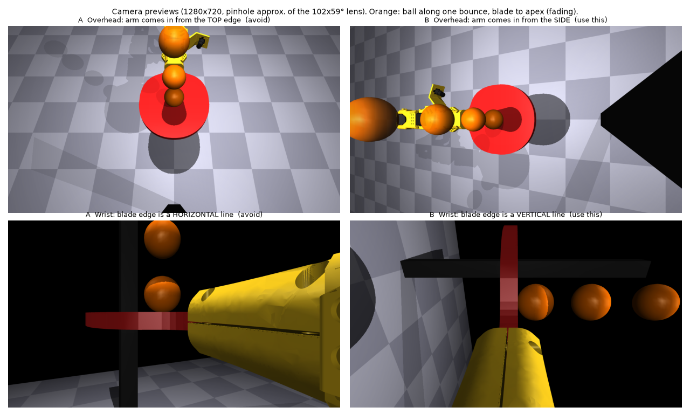

# Camera setup

Two InnoMaker U20CAM-720P modules (the 32x32 mm UVC camera recommended by the SO-ARM100 repo): 1280x720 MJPEG at
30 fps, rolling shutter, 120° diagonal / 102° wide / 59° tall wide-angle lens. One overhead, one on the wrist.

The picture is a wide rectangle. **Turn both camera boards so the ball's up-and-down travel runs along the long
edge of the picture** (102° of view instead of 59°). The boards are square with four symmetric screw holes, so
this is a quarter turn of the board in its mount; nothing else changes.



*A = avoid, B = use this. Orange: the ball at five heights along one bounce, from the blade to the apex.
Rendered from the sim model (`sim/scripts/render_camera_views.py`); the render's lens is narrower than the real
one, which sees a bit more and curves at the edges.*

## Overhead camera

- SO-ARM100 overhead mount ([guide](https://github.com/TheRobotStudio/SO-ARM100/blob/main/Optional/Overhead_Cam_Mount_32x32_UVC_Module/README.md)),
  but free-standing: the post stands **24 in (0.61 m) in front of the arm base**, on the arm's straight-ahead line,
  with the camera plate (tilted 25° down) facing back toward the arm. The lens ends up ~0.55 m above the table and
  ~18 cm in front of the bounce point.
- **Print `cad/overhead_mount/cam_mount_top_rotatable.stl` instead of the stock `cam_mount_top.stl`.** The stock
  plate's cross-shaped lens-holder cutout only lets the board sit with the picture's long edge across the arm. The
  modified part adds the same cutout turned 90° (a plus-shaped opening), so the board fits either way; nothing
  else changes (`cad/overhead_mount/make_rotatable_top.py` regenerates it from the upstream STL).
- **Portrait, as seen from the camera's position**: as if you were filming the bounce with a phone held upright
  from where the camera stands. The long edge of the picture runs from the near table up toward the arm. This
  matters a lot: in the sim (fitted servos, 20 s) the scripted bouncer keeps the ball up in 62 % of runs with both
  cameras (77 % overhead only) vs 31 % (11 %) with the overhead camera across, which sees the ball in ~40–50 % of
  frames instead of ~80 %.
- **Check in the preview** (`ffplay /dev/videoN`, `cheese`, ...): the arm and paddle come in from the **left or
  right edge**, and the ball moves **sideways** as it rises. If the arm comes in from the top or bottom edge, turn
  the board a quarter turn. The preview looks rotated on the monitor; that is correct — leave it, calibration
  measures the exact orientation.

## Wrist camera

- Stock SO-ARM100 hex-nut wrist camera mount on the paddle holder (`cad/holder/`), on the robot's left side at
  the ready pose, looking along the paddle at the blade centre from ~0.2 m, at blade height.
- **Long edge across the blade face, not along it**: with the paddle level, the long edge points straight up
  (perpendicular to the blade surface), like a phone held upright.
- **Check in the preview** with the paddle level: the blade is seen edge-on as a thin line, and that line is
  **vertical**; the ball moves **left-right** as it rises off the blade. If the blade looks like a horizontal line,
  turn the board a quarter turn. The paddle holder fills part of the picture; it does not block the ball's path.

Why: in the sim the ball stays in view in ~80 % (overhead) / ~55 % (wrist) of frames this way, vs ~45 % / ~25 %
turned the other way, and the scripted bouncer keeps the ball up 3× as often (38 % vs 12 % of runs).

## Image settings

- 1280x720 MJPEG, 30 fps.
- **Manual exposure, 2 ms or less**, with bright light on the bounce area. Auto exposure indoors is 10–30 ms, which
  smears the ball over 2–7 cm at 2.4 m/s. Auto white balance off too. Controls (names vary by kernel; list them
  with `v4l2-ctl -d /dev/videoN --list-ctrls`):

  ```bash
  v4l2-ctl -d /dev/videoN -c auto_exposure=1 -c exposure_time_absolute=20   # manual, 20 x 100 us = 2 ms
  v4l2-ctl -d /dev/videoN -c white_balance_automatic=0
  ```

## Calibration targets

Timestamps and calibration matter more than noise, frame rate or latency (sim results in `TODO.md` §3).
Targets, each camera:

| What | Target |
|---|---|
| Overhead camera position / angle in the robot frame | ≤ 3 mm / ≤ 0.3° |
| Wrist camera mount (on the holder) | ≤ 1 mm / ≤ 0.5° |
| Timestamp offset (capture time of each frame) | ≤ ±2 ms |

The procedures (paddle AprilTag for the overhead camera, a fixed tag for the wrist mount, arm motion vs encoders
for the timestamp offset) are listed in `TODO.md` §3.
