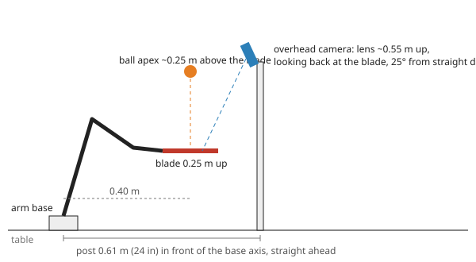

# Hardware setup

Everything the sim assumes about the real rig, in the order you build it. Camera mounting details are in
[`camera_setup.md`](camera_setup.md); the plan and the measurements behind each number are in [`TODO.md`](../TODO.md).

## Parts

| Part | Notes |
|---|---|
| SO-101 follower arm, 5 servos | Feetech STS3215 **12 V / 30 kg·cm** on IDs 1–5 (pan, lift, elbow, wrist_flex, wrist_roll). The gripper servo (ID 6) and jaw come off. |
| 12 V supply + bus adapter | The arm's usual supply and USB servo board; the arm shows up as `/dev/ttyACM0` (or under `/dev/serial/by-id/`). A switch on the 12 V line you can reach. |
| Paddle holder | `cad/holder/` two-piece clamp (replaces the wrist-roll follower part), 4× M3x10 into M3 heat-set inserts. |
| Paddle | NIBIRU SPORT, clamped in the holder; the **cap-side face hits the ball** (faces up at the ready pose). |
| Wrist camera | InnoMaker U20CAM-720P on the stock hex-nut 32x32 mount, on the holder's side (2× M3x8 + nuts). |
| Overhead camera | Second U20CAM-720P on the SO-ARM100 overhead mount, **top section reprinted** as `cad/overhead_mount/cam_mount_top_rotatable.stl`. |
| Balls | 40 mm 3-star ABS (2.75 g). Orange is easier to separate from a white wall and the arm. |
| Lighting | Bright, diffuse, **flicker-free** LED (DC or high-frequency driver). |
| Calibration targets | One printed AprilTag on the paddle's back face, one printed ChArUco board (see [AprilTags](#apriltags-and-calibration-targets)). |
| Host | The training PC: USB for the servo board and both cameras; the control loop runs on the CPU at 100 Hz. |

## 1. Arm

1. Calibrate the arm with LeRobot as usual (it writes the homing offsets and position limits the bus code reads).
   The joint map that converts servo ticks to sim angles already exists (`measurements/servo/joint_map.json`,
   from `uv run scripts/record_servos.py map`); redo it only after re-calibrating with LeRobot or swapping a servo.
2. Remove the gripper servo and jaw; bolt the holder to the wrist-roll horn (same 4 M3 screws and roll zero as
   the stock follower part).
3. Clamp the paddle: handle waist in the holder's pocket, **cap-side face = hitting face**. Check the blade is
   flat in the holder; a few degrees of tilt walks the ball off the paddle (1° ≈ 3 cm drift per bounce at a
   25 cm apex).
4. Wrist camera on the holder, board turned so the picture's long edge is **perpendicular to the blade**
   (camera_setup.md, "Wrist camera").
5. Clamp the arm base to the table. The sim's origin is the base mounting face under the pan axis; "in front"
   means along the arm's straight-ahead direction at pan = 0.

Servo gains are written by the code at startup: the fitted P per joint (pan 16, lift 64, elbow 64, wrist_flex
32, roll 64), I = 0, D = 0, Acceleration 0. The model and the policy assume exactly these; don't change them in
LeRobot.

## 2. Layout

- **Bounce point:** 0.40 m in front of the base axis, blade 0.25 m above the base mounting face, ball apex
  ~0.25 m above the blade.
- **Overhead post:** 0.61 m in front of the base on the straight-ahead line, plate facing back toward the arm.
  Within ±5 cm / ±5° is fine (training covers that); calibration measures the exact pose.
- **Clear space:** nothing within ~0.3 m of the bounce point up to ~0.6 m height. Episodes in training end when
  the ball drifts 0.2 m from the target, so it lands anywhere in that circle; a towel underneath saves chasing balls.
- **Background:** matte and dark where the cameras look: a dark cloth on the table under the bounce (overhead
  view) and a dark board or cloth beyond the bounce in the wrist camera's view (it looks forward and across,
  toward the overhead post). No orange or white clutter in either picture.
- **Light:** bright enough for a **≤ 2 ms manual exposure** (camera_setup.md, "Image settings"). Use flicker-free
  LEDs: at 2 ms the rolling shutter turns mains flicker into bright and dark bands across the picture.

## 3. Wiring

- 12 V supply → servo board → arm; servo board USB → PC.
- Each camera on its own USB port. Two 720p MJPEG streams at 30 fps fit easily on USB 2; avoid unpowered hubs.
- Note the stable device names: `ls /dev/v4l/by-id/` (cameras) and `ls /dev/serial/by-id/` (servo board). The
  two cameras are the same model, so tell them apart by port path (`/dev/v4l/by-path/`) and keep them plugged
  into the same ports.

## 4. Cameras

Follow [`camera_setup.md`](camera_setup.md): mount orientation (long edge along the tilt / across the blade),
preview checks, manual exposure ≤ 2 ms, auto white balance off.

## AprilTags and calibration targets

**Yes, one AprilTag, and one ChArUco board.** Neither is used while bouncing (the policy only sees the ball, and the
arm's pose comes from the encoders); they are for calibration, which the sim says matters more than noise, frame rate or
latency.

| Target | Where | Used for | Accuracy needed |
|---|---|---|---|
| **AprilTag**, tag36h11 ID 0, ~70 mm black square | Glued flat on the paddle's **back face** (base side, the face that never hits); roughly centred, exact placement doesn't matter | Overhead camera position and angle in the robot frame; each camera's timestamp offset; joint zero offsets as a by-product | Overhead ≤ 3 mm / ≤ 0.3°; timestamps ≤ ±2 ms |
| **ChArUco board**, 5×7 squares of 30 mm (DICT_5X5_100) | Printed, glued flat to a rigid board (foam board, stiff cardboard) | Lens model of each camera (wave it in front of the camera); then standing upright on the table in front of the arm as the fixed target for the wrist camera mount | Wrist mount ≤ 1 mm / ≤ 0.5° |

Both print on US Letter at exact scale: `uv run scripts/make_calib_targets.py`, then
`lp -o print-scaling=none -o media=Letter build/calib_targets.pdf` (page 1: tag ID 0 plus a spare, page 2: the
board, each with a 100 mm ruler). Measure the ruler, the tag's black square and a board square with calipers;
`calibrate.py targets` records them and the calibration uses those numbers.

Why the tag goes on the paddle rather than on the table: the arm moves it through ~20 poses where the encoders and
the model already say where the paddle is, so the overhead camera's pose comes out directly in the robot frame
(the tag's exact spot on the blade is solved along with it). A tag fixed to the table would need its own
position measured relative to the arm. The wrist camera can't see the paddle face (it's mounted on the paddle and
looks across the blade edge-on), hence the fixed board for it. To show the back-face tag to the overhead camera,
the arm rolls the paddle over (wrist_roll reaches ±157–163°).

## Bring-up and calibration

All from `sim/`. Each step saves into `measurements/calibration/` (`rig.json`, `camera_<name>.json`, `arm.json`, raw
data in `raw/`), and later steps refuse to run until the ones they need are done. Every arm step plans its moves,
checks them in the sim (joint and servo limits, table clearance, blade vs arm) and asks for "go"; Ctrl-C returns
the arm to where it started, a second Ctrl-C cuts torque.

**Start every arm step from the folded rest** (the pose the limp arm falls into: upper arm back, forearm folded up,
paddle pointing up). With the paddle resting tip-down on the table, joint offsets of a few degrees (measured later
by step 5) put the tip "inside" the table in the model, and the check refuses to move.

Aim the overhead camera with the arm at the real ready pose:
`uv run scripts/arm_pose.py ready --port /dev/ttyACM0 --snapshot overhead wrist` moves there, saves both pictures
to `sim/build/snapshots/` with the paddle face's pixel position, and returns. Planned: paddle centre near
(715, 360) in the overhead picture (arm entering from the right), blade a vertical strip mid-picture in the wrist one.

| # | Command | What you do | Result |
|---|---|---|---|
| 0 | `uv run scripts/calibrate.py selftest` | nothing (no hardware) | the solvers recover known answers from synthetic data |
| 1 | `uv run scripts/calibrate.py targets --ruler 100.0 --tag 70.1 --square 30.0` | type your caliper readings | sizes used by all fits |
| 2 | `uv run scripts/cameras.py list`, then `cameras.py assign overhead <device>` and `assign wrist <device>` | plug in one camera at a time to tell them apart (use the `/dev/v4l/by-path/` names) | `rig.json` |
| 3 | `uv run scripts/cameras.py preview overhead` (and `wrist`) | check orientation (camera_setup.md), set exposure with +/- (≤ 2 ms, picture still bright), toss the ball: it should be found in most frames | exposure saved; ball colour via `cameras.py color` |
| 4 | `uv run scripts/calibrate.py intrinsics overhead` (and `wrist`) | wave the board: still for a moment at each spot, all over the picture including the corners, tilted up to ~45°, near and far | lens model, RMS ≲ 0.5 px |
| 5 | `uv run scripts/calibrate.py overhead --port /dev/ttyACM0` | tag on the paddle's back face; the arm rolls the paddle over and shows it to the overhead camera in ~20 poses | camera pose, joint offsets, tag placement |
| 6 | `uv run scripts/calibrate.py wrist --port /dev/ttyACM0` | board standing upright ~0.3 m beyond the paddle tip, facing the arm, centre at paddle height; the arm moves around ready | wrist camera mount |
| 7 | `uv run scripts/calibrate.py timing overhead --port ...`, then `timing wrist` (board untouched since step 6) | the arm waves the paddle for 12 s | each camera's timestamp offset and rolling-shutter readout |
| 8 | `uv run scripts/calibrate.py gravity --port /dev/ttyACM0` | drop the ball onto the paddle from 20–40 cm, catch it, repeat for 40 s | gravity tilt (< 0.5°) and magnitude (within 2 %): checks everything above |
| 9 | `uv run scripts/run_robot.py --port /dev/ttyACM0 --scripted --seconds 60` | hold the ball above the paddle and let go | the scripted bouncer alone: a first test of the whole loop |
| 10 | `uv run scripts/run_robot.py --port /dev/ttyACM0 --policy policies/residual_v1` | same | the trained policy; logs in `measurements/runs/<time>/` |

Why each step exists:

- **Lens:** fisheye model (barrel distortion beyond −17 % at the edges), fitted from ChArUco corners.
- **Overhead pose:** the tag's corners at ~20 arm poses, with the encoder angles there, fit the camera pose in the
  robot frame, where the tag sits on the blade, and joint zero offsets (lift, elbow, wrist_flex, wrist_roll). The
  tag is assumed flat on the blade: that is what makes the wrist_roll offset (the paddle's sideways tilt)
  measurable.
- **Wrist mount:** the board's corners seen from ~20 poses fit the camera's mount on the holder (CAD as the start)
  and where the board stands.
- **Timing:** the target's track against the encoders gives the capture time of each frame relative to the driver's
  buffer timestamp (to < 1 ms in the selftest) and the rolling-shutter readout across rows.
- **Gravity:** ball flights fitted with drag; a tilted result means the robot frame the cameras report in is tilted,
  which shows up as a paddle-tilt error (1° ≈ 3 cm of drift per bounce).

## Running

`scripts/run_robot.py` loads the calibration, connects the arm (gain profile, torque on), starts both cameras and
moves to the ready pose, then runs at 100 Hz: encoders and ball detections go through the same controller code as
training (filter, impact prediction, scripted bouncer, observation layout from `policy.json`) into the ONNX policy.
The arm holds ready until the ball is tracked above the paddle (held or dropped), plays until the ball is lost, low
or more than 25 cm away, then returns to ready and waits for the next ball. Goals are limited to 0.15 rad per tick
and kept off the table (blade ≥ 12 cm up) and below 45° of tilt; the watchdog stops on a stuck joint, heat or low
supply. `--sim` runs the same loop against the simulated arm, ball and cameras: work per tick is ~2.5 ms median,
~5 ms p99 on this PC, inside the 10 ms tick with the bus I/O.

## Safety

- Keep the 12 V switch within reach. The arm goes limp when power is cut; at the ready pose the paddle drops onto
  the table, so keep the area under it clear.
- Stay out of the arm's reach while it runs: strokes reach ~0.6 m/s at the blade and the pan joint can swing.
- Start a run with the ball in your hand above the paddle; the controller waits for a converged ball track
  before it strikes. Releasing a ball you're holding is part of training (held 0–1 s, then let go).

## Software status

| Piece | State |
|---|---|
| Servo bus, joint map, arm session (`servo_bus.py`, `real/arm.py`, `record_servos.py`) | Done, used for the servo recordings |
| Ball filter, scripted bouncer, controller (`ball_filter.py`, `bouncer.py`, `controller.py`) | Done, shared with training; single-world CPU fast paths (`tests/test_fast_paths.py`) |
| Trained policies, ONNX + spec (`sim/policies/<name>/`) | `residual_v1` (deploy first), `residual_v2`, `direct_v3` |
| Camera capture + ball detection (`real/cameras.py`, `scripts/cameras.py`) | Written; detection checked on synthetic frames. Needs the cameras: exposure, colour thresholds, buffer timestamps |
| Camera model and calibration files (`real/camera_model.py`) | Done; exercised by `run_robot.py --sim` |
| Calibration (`scripts/calibrate.py`, `real/calib_solve.py`) | Written; `selftest` passes. Needs the arm and cameras |
| 100 Hz loop (`scripts/run_robot.py`) | Runs end to end in `--sim` (bounces continuously, 100 % tracked). Needs the arm |
